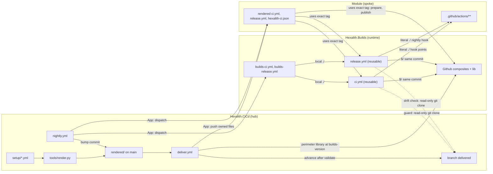
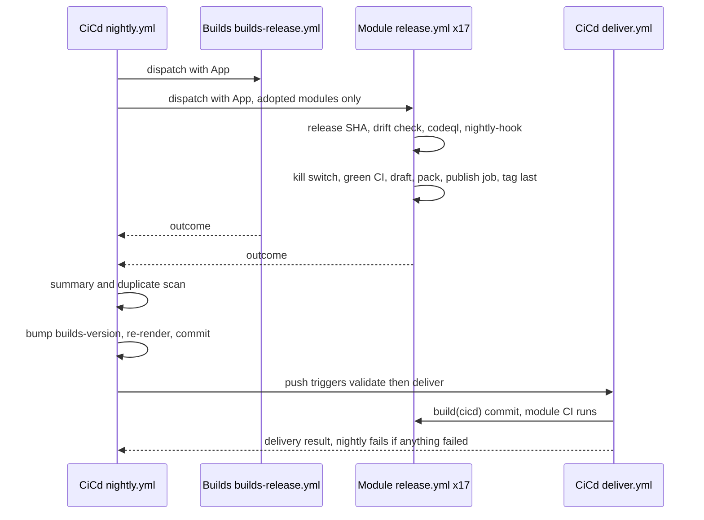
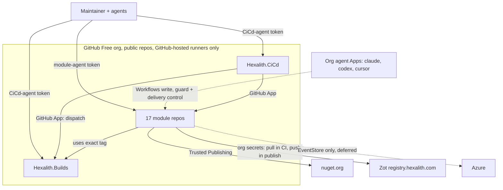

# Architecture Spine — Hexalith.CiCd

## Precedence

Where SPEC-cicd, its companions, or `stories.yaml` conflict with this spine, the spine wins until the spec is refreshed. The known deltas:

| Spec / story text | Superseded by |
| --- | --- |
| CAP-1, CAP-16: all 18 repos managed alike | Builds is the runtime, not a managed spoke (AD-19) |
| CAP-8: "no change persists beyond the next CI run" | For `.github/workflows/**`, repaired by the next delivery (≤ 1 h) (AD-8) |
| CAP-4: "submodule + setup file onboards a repo" | Also needs the maintainer preconditions (AD-21) |
| CAP-6: "within one night of a Builds release, all modules reference it" | Only within the current major and not for tags in `builds-skip` (AD-10) |
| CAP-5, `pipeline-stages.md`: browser and Dapr topologies get their own job | They run in the main job via the `browsers`/`dapr` knobs; `jobs` is only for another OS (AD-12) |
| Perimeter: "commitlint and semantic-release config" rendered into modules | Must be absent; shared config lives in Builds. The perimeter adds `hexalith-ci.json`, `.gitmodules` and the instruction blocks (AD-4). |
| Non-goal "central failure reporting" | `nightly.yml` aggregates pass/fail only (AD-18) |
| CAP-13 / story 8: staggered start times | Everything is dispatched at once (AD-18) |
| Story 7: separate Builds bumper | The bump is a CiCd commit that delivery ships (AD-6, AD-18). Story 4 owns `deliver.yml`. |
| Builds releasable only via `fix(deps)` (OQ1) | Builds releases on every type except `docs`, `test`, `style` (AD-10) |
| "Restored files tested only on the next push" | The restore job dispatches CI (AD-8) |
| Release: semantic-release tags, then publishes | Draft-marker state machine, tag last, publish job in the module caller (AD-17) |
| CodeQL findings "appear before the release" (OQ3) | CodeQL, the nightly hook and NU1903/NU1904 block the release (AD-17, AD-18) |
| Dependency review dropped if `-warnaserror` restore fails audits | Dropped. The audit gate sits only in the release build. Waivers live only in Builds (AD-10, AD-12, AD-17). |
| Stories 11–26: "push with the delivery credential" | No agent pushes owned files; one delivery commit adopts the module (AD-21) |
| Hook points "after the build or after unit tests" | Only `after-unit-tests`, `after-integration-tests`, `nightly` (AD-14) |
| Separate job for "a slow, independent suite" | Not used. Extra jobs only for another OS, after the main job (AD-12). |
| CAP-11: instructions via AI.Tools' shared file | Delivered marker block in each module's instruction files (AD-4) |
| Story 1 spike scope | Only the items under Deferred remain to verify |

## Design Paradigm

**Hub-and-spoke desired-state reconciliation.** Hexalith.CiCd holds the desired state of every module's CI/CD and is the only writer of it into modules. Hexalith.Builds is the shared, module-agnostic runtime, consumed only by exact release tag. It is not a spoke (AD-19). Modules run what is committed in them, and the guard reconciles drift back to the last validated desired state.

| Role | Unit | Lives in |
| --- | --- | --- |
| Desired state (input) | per-module setup file | CiCd `setup/<Repo>.yml` |
| Desired state (output) | rendered owned files + perimeter | CiCd `rendered/<Repo>/…`, `rendered/<Repo>.perimeter.json`; validated copy on branch `delivered` |
| Controller | validate + deliver, nightly scheduler, duplicate scan | CiCd `tools/*.py`, `.github/workflows/` |
| Shared runtime | reusable CI and release workflows, composites, guard, perimeter library, local check, schemas | Builds |
| Spoke (×17) | rendered callers + config, module-owned custom actions, product | each module repo |

## Invariants & Rules



These arrows are the allowed dependencies. Builds never names a module, modules never reference CiCd, and custom actions never call Builds.

### AD-1 — CI is materialized in the module's commit [ADOPTED]

- **Binds:** CAP-1, CAP-2, CAP-3, CAP-5, CAP-12
- **Prevents:** a SHA's CI or release result depending on CiCd's state at run time
- **Rule:**
  - A module's CI/CD configuration is the rendered `.github/hexalith-ci.json`: `builds_tag`, `solution`, `dapr`, `browsers`, `registry`, `codeql`, `tests`, `hooks` and `jobs`.
  - Builds' CI, Builds' release and `check.py` read it from the checkout.
  - The rendered callers carry only what `uses:` and job structure need: the Builds tag, triggers, permissions, concurrency, extra-OS jobs and the publish job.
  - At run time Builds reads CiCd only for the guard's comparison (AD-8).

### AD-2 — Builds is module-agnostic [ADOPTED]

- **Binds:** CAP-1, CAP-2, CAP-5, CAP-15
- **Prevents:** per-module branches in shared CI/CD code that only one module exercises
- **Rule:** Builds' workflows, composites and scripts contain no module names, lists or module-specific conditions. All variation comes from `hexalith-ci.json` and the perimeter. The package catalog in `Props/` is product build data and is outside this rule.

### AD-3 — Setup files are the module registry and the only per-module input

- **Binds:** CAP-4, CAP-9, CAP-13, CAP-16; render, deliver, nightly, duplicate scan
- **Prevents:** divergent module lists; free-form knobs; overrides that silently never apply; one module's state blocking all others
- **Rule:**
  - The managed modules are exactly `setup/*.yml` (file name = repo name), and every CiCd tool enumerates them. `setup/Hexalith.Builds.yml` is rejected (AD-19).
  - A setup file is `hexalith-ci.json` without `builds_tag`. It is validated against Builds' `schemas/hexalith-ci.v1.json` at `builds-version`, and unknown keys fail.
  - **Knobs:**
    - `solution`: a repo-relative path, or `none`, which runs stage 1 only and releases a GitHub release only.
    - `dapr`, `browsers`, `registry`.
    - `codeql`: languages, never `actions`. The default is `[csharp]`, or `[]` with `solution: none`. `[]` skips analysis.
    - `tests.integration`, `tests.exclude`, `hooks`, `jobs`.
  - Adding a knob is a minor Builds release (AD-10).
  - **Global checks**, which gate all delivery: render with no diff, schemas, tool tests, linting.
  - **Per-module checks**, which gate only that module's delivery:
    - the repo is a submodule and in the App installation;
    - every action named by `hooks`, `jobs` or `tests.exclude` exists on the module's live `main`;
    - no job name equals a hook name;
    - every `tests.exclude` target is an enabled hook or job;
    - the AD-21 preconditions readable with the App's permissions are met.
  - CiCd tools read module content from shallow clones of the module's live `main`, never from CiCd's submodule checkouts.

### AD-4 — Owned perimeter per module

- **Binds:** CAP-1, CAP-8, CAP-11; render, guard, restore, deliver
- **Prevents:** guard, restore and delivery disagreeing on what is owned or how it is compared; a format change breaking pinned guards; drifting copies of shared tool config; false drift from line endings
- **Rule:**
  - The render emits `rendered/<Repo>.perimeter.json` in the format `schemas/hexalith-perimeter.v1.json` (Builds public API, field `format: 1`).
  - **Closed entry kinds:** `whole`, `whole-dir`, `gitlink`, `gitmodules-section`, `json-superset`, `marker-block`, `absent-glob`, `absent-json`, `absent-line`.
  - Partial-entry text is inline. Whole-file content is `rendered/<Repo>/<path>`.
  - The guard fails with a fixed message on an unknown `format` or kind. A format change is a Builds major (AD-10).
  - One perimeter library in Builds compares and applies entries. The guard, restore and delivery all use it, and Builds hard-codes no path list.

  | Path | Kind |
  | --- | --- |
  | `.github/workflows/` | `whole-dir`: an unrendered file is drift |
  | `.github/hexalith-ci.json`, `.github/dependabot.yml` | `whole` |
  | `references/Hexalith.Builds` | `gitlink` = `builds_tag`, resolved with `^{}` |
  | `.gitmodules` section for `references/Hexalith.Builds` | `gitmodules-section`: `path` and `url` only, no `branch` or `update` |
  | `.claude/settings.json` `permissions.deny` | `json-superset`; every other key is module-owned |
  | `AGENTS.md`, `CLAUDE.md`, `.github/copilot-instructions.md` | `marker-block` between `<!-- hexalith-cicd:begin -->` and `<!-- hexalith-cicd:end -->` |
  | `.releaserc*`, `release.config.*`, `commitlint.config.*`, `**/bmad-testarch-ci/**` | `absent-glob` |
  | `release`/`commitlint` keys and `semantic-release`/`@commitlint/*` dependencies in `package.json` | `absent-json` |
  | commitlint in `.husky/commit-msg` | `absent-line` |
  | `.github/actions/**` | module-owned: linted and scanned, never restored |

  - Whole files are compared as git blobs. The render writes LF, UTF-8 without BOM, and a final newline.
  - Partial entries are judged semantically and edited minimally, only when the check fails.
  - semantic-release, its plugins and commitlint, with their config and npm pins, exist only in Builds.

### AD-5 — Rendering is committed with its cause

- **Binds:** CAP-4, CAP-6
- **Prevents:** setup and rendered output drifting apart in CiCd; bot commits racing authors
- **Rule:**
  - Whoever changes `setup/`, `templates/`, `builds-version` or `builds-skip` runs `uv run tools/render.py` and commits the change together with `rendered/`. This includes the nightly bump and every rollback.
  - The global checks re-render and fail on any diff.
  - The only automated CiCd commits are the nightly bump and the keepalive (AD-18).

### AD-6 — One write path into modules

- **Binds:** CAP-4, CAP-6, CAP-8, CAP-11
- **Prevents:** several writers pushing conflicting owned-file states; unvalidated renders reaching modules or the guard; stale renders written back after a race
- **Rule:**
  - CiCd `deliver.yml` is the only writer of owned files into modules. The one exception is the AD-8 restore job.
  - `deliver.yml` is a top-level workflow only. It runs a `validate` job, then a `deliver` job, but `deliver` runs only on `main` and only after `validate`'s global checks pass in the same run.
  - **Triggers:** push (validate only off `main`), `pull_request`, hourly at minute 47, manual dispatch.
  - **On a passing run:**
    1. Advance branch `delivered` to the validated commit.
    2. For each module that passes its own checks, take a shallow sparse clone of the live `main` and apply the perimeter with Builds' perimeter library, taken from a shallow clone of Builds at `builds-version`.
    3. If there is no diff, push nothing. Otherwise push one `build(cicd): …` commit with an App token.
    4. If the push is not a fast-forward, re-fetch and re-apply (at most 3 times). Never rebase, never force-push.
  - A module that fails its checks is skipped and reported, and the run fails. The other modules are still delivered.
  - The hourly run also fails if the last `nightly.yml` run is more than 26 hours old.

### AD-7 — Credentials

- **Binds:** CAP-7, CAP-8, CAP-13; every CiCd workflow
- **Prevents:** unattended paths dying on token expiry; module runs or agents holding cross-repo write power; agents bypassing CiCd through its own repos
- **Rule:**
  - **The App.** One org-owned GitHub App has Contents, Workflows and Actions read & write, and Administration, Variables and Code scanning alerts read. It is installed on selected repos: the 17 modules, Builds and CiCd. Preconditions it can't read are a manual checklist (AD-21).
  - **The key.** It exists only as the CiCd secret `HEXALITH_CICD_APP_PRIVATE_KEY`. Each job mints a token with `actions/create-github-app-token`, scoped to the repos and permissions it needs. The key never enters a module, Builds or an agent session.
  - **Module agents.** A fine-grained token on module repos only, with Contents and Pull requests write. It has no Workflows, Administration, Actions, Variables or Secrets write.
  - **CiCd agents.** A fine-grained token on Builds and CiCd only, with Contents, Workflows and Actions write, for interactive sessions only.
  - **App-based agents.** Org-wide agent Apps (`claude`, `chatgpt-codex-connector`, `cursor`) hold Workflows write that the org cannot remove. The guard, the release drift check (AD-17) and hourly delivery are their control.
  - Nothing unattended uses a personal token.

### AD-8 — Guard and restore

- **Binds:** CAP-7, CAP-8, CAP-9, CAP-11
- **Prevents:** the guard enforcing an unvalidated render; custom actions holding write tokens; restore loops; restore splitting the lockstep set; module-owned audit or gate bypasses
- **Rule:**
  - The guard is stage 1 of every CI run. It reads the perimeter and expected files by shallow sparse git clone of CiCd branch `delivered`, never `main`, `raw.githubusercontent.com` or the REST contents API.
  - **It checks:**
    - the AD-4 perimeter;
    - that every enabled hook and job action exists;
    - the custom-action deny list (`enforcement.md`);
    - no `NoWarn` containing NU1903 or NU1904, and no `NuGetAuditSuppress`, in module MSBuild files;
    - commitlint (PR: base..head; push: before..after; dispatch: `HEAD`).
  - **PR or non-`main` push:** fail with the diff and the ownership message.
  - **Push to `main`:** fail the same way. A separate `restore` job (`GITHUB_TOKEN`: `contents: write`, `actions: write`) applies the perimeter in one commit, then dispatches `ci.yml` on `main`. It skips `.github/workflows/**`. It writes the gitlink, the `.gitmodules` section and `hexalith-ci.json` only when the perimeter's tag equals the running workflow's tag. On a non-fast-forward it stops; the newer commit's own CI takes over.
  - **`workflow_dispatch`:** check only, never restore.
  - What restore skips waits for the next delivery, at most one hour later.
  - The CI build job has `contents: read`.

### AD-9 — Builds code runs from the workflow's own commit

- **Binds:** CAP-1, CAP-3, CAP-6, CAP-8
- **Prevents:** a re-pinned Builds pointer running an older guard that approves its own downgrade; two Builds versions in one run
- **Rule:**
  - Builds reusable workflows reference their own composites with `$/…`, and scripts resolve via `GITHUB_ACTION_PATH`.
  - Callers reference Builds composites (`prepare`, `publish`) at the same exact tag as the workflows.
  - The module's `references/Hexalith.Builds` is data only: MSBuild props and the local check.
  - Fallback if `$/` fails in story 2: Builds checks itself out at `builds_tag` from `hexalith-ci.json`.

### AD-10 — Builds versioning and lockstep

- **Binds:** CAP-6, CAP-15, CAP-16
- **Prevents:** modules on different Builds versions; auto-bumps to an interface the render doesn't match; rollbacks undone overnight; central package changes that never release; waivers spread across modules
- **Rule:**
  - **Public API (semver).** Builds' public API is:
    - the reusable workflows' `workflow_call` inputs, secrets and outputs, and the caller permissions they require;
    - the `prepare` and `publish` composite interfaces;
    - `schemas/hexalith-ci.v1.json` and `schemas/hexalith-perimeter.v1.json`;
    - the `check.py` command line;
    - the MSBuild property names Builds reads or passes (`UseHexalithProjectReferences`, which modules define, and `HexalithPublishContainer`).

    The global checks validate rendered callers, `hexalith-ci.json` and perimeters against `builds-version`.
  - **Lockstep.** Modules reference Builds only by exact release tag, in callers, `hexalith-ci.json` and the gitlink, all moved together by delivery.
  - **Auto-bump.** The nightly auto-bump moves `builds-version` to the newest tag in the current major that is not in `builds-skip`.
    - A new major is adopted by one CiCd commit that changes `builds-version` and the templates together.
    - A rollback sets `builds-version` to the older tag, adds the bad tag to `builds-skip`, and removes setup keys that the older schema lacks.
  - **Release rules.**
    - Builds releases on every commit type except `docs`, `test` and `style`.
    - In modules, `feat`, `fix` and `perf` release; `build`, `ci` and `build(deps)` don't; `fix(deps)` does.
  - **Audit waivers.** NuGet audit waivers (`NuGetAuditSuppress`) exist only in Builds `Props/`, and only CiCd agents change them.
  - **Dependabot.** Module `dependabot.yml` never enables `github-actions` or `gitsubmodule`, and uses the prefix `build(deps)`.

### AD-11 — One language, scripts only

- **Binds:** all Builds and CiCd logic; CAP-3
- **Prevents:** logic spread across languages; untested inline YAML logic; CI and the local check running different code
- **Rule:**
  - All logic is Python ≥ 3.12. Builds' own CI runs the script tests on 3.12 and on the runner's `python3`.
  - Builds runtime scripts use the standard library only. CiCd tools declare PEP 723 inline dependencies and run with `uv run`.
  - The parts of `prepare` that run on Windows (checkout, .NET setup, restore, build) contain no Python. Environment setup that needs Python runs on Linux only.
  - A workflow `run:` step only invokes a script, except for one-liners.
  - Third-party tools are called from scripts and pinned in Builds or CiCd.
  - Custom actions are module-owned and not bound by this rule.

### AD-12 — CI job shape

- **Binds:** CAP-2, CAP-5, CAP-10, CAP-14
- **Prevents:** late failure reporting; hooks or integration tests running after a unit failure; environment setup duplicated in custom actions; CI and the local check building differently; advisories turning CI red
- **Rule:**
  - CI is one job, in this order:
    1. Guard and commitlint.
    2. Restore, then a Release build with `-warnaserror -p:UseHexalithProjectReferences=false -p:NuGetAudit=false`. That means package mode, and no audit in CI.
    3. Unit tests, project by project, stopping at the first failing project (AD-13).
    4. Builds environment setup, run once:
       - Dapr if `dapr`, at the one Dapr version pinned in Builds;
       - browsers if `browsers`, or if stage 4 holds an E2E project;
       - registry login if `registry`, with the pull-only pair.

       Then hook `after-unit-tests`, then integration tests project by project, then hook `after-integration-tests`.
  - `solution: none` runs stage 1 only.
  - Only the Builds submodule is checked out.
  - No CodeQL runs on a push or PR.
  - The module `ci.yml` triggers on `push`, `pull_request` and `workflow_dispatch`.
  - A custom action that needs browsers or Dapr is a hook with that knob on. `jobs` exist only for another OS. They are rendered with `needs: ci` and two steps: `uses: Hexalith/Hexalith.Builds/Github/prepare@<tag>`, then a literal `uses: ./.github/actions/<job-name>`.

### AD-13 — Test-stage classification

- **Binds:** CAP-2, CAP-3, CAP-10
- **Prevents:** silent test loss; gate erosion through module-owned skips; CI and the local check classifying differently
- **Rule:**
  - Test projects are the projects in `solution` whose MSBuild `IsTestProject` is `true`. There is never a file glob.
  - A project is identified by its repo-relative `.csproj` path, with forward slashes.
  - Default stage: a name ending in `IntegrationTests`, `Integration.Tests` or `AppHost.Tests`, or containing `E2E`, goes to stage 4. Everything else goes to stage 3.
  - The only overrides are `tests.integration` and `tests.exclude` (project → enabled hook or job). There is no plain skip.
  - Projects run in ordinal path order within a stage.
  - One classifier in Builds serves CI and the local check.

### AD-14 — Custom-action contract

- **Binds:** CAP-5, CAP-9, CAP-10
- **Prevents:** custom actions growing into a second pipeline; hooks with divergent shapes, permissions or secrets
- **Rule:**
  - Custom actions are composite only, at `.github/actions/<hook-name or job-name>/action.yml`.
  - The hooks are exactly `after-unit-tests`, `after-integration-tests` and `nightly`, with one action per hook point. That action may call local sub-actions.
  - An action may use any language. It assumes a restored, Release-built workspace with the Builds environment set up, and never rebuilds or sets up an environment.
  - It gets a read-only token and no secrets. The registry session is pull-only. Hook secrets (EventStore) arrive at story 20 as a minor Builds API change, passed explicitly by name.
  - Directories that are not enabled stay dormant: linted and scanned, never run.
  - Failure means a failed step. Actions write no result or evidence files.

### AD-15 — Local check mirrors CI stages 1–3

- **Binds:** CAP-3
- **Prevents:** a local pass followed by a CI fail on the same commit
- **Rule:**
  - `python3 references/Hexalith.Builds/check.py` reads `.github/hexalith-ci.json`.
  - It first checks that both the `HEAD` gitlink and the checked-out submodule commit equal `builds_tag`.
  - It then runs the same guard (commitlint over `origin/main..HEAD`), the same build flags and the same classified unit-test scripts as CI.
  - Hooks never run locally. There is no pre-push hook.

### AD-16 — The release SHA and its green CI

- **Binds:** CAP-12, CAP-13
- **Prevents:** releasing an untested commit; release and CI disagreeing about "green"; gates vouching for a different commit than the one shipped; pushes during the night changing what is released
- **Rule:**
  - The first job of the reusable release resolves the release SHA once: the SHA of the marked draft if one exists, otherwise `github.sha` of the dispatched run. Every gate and the build use it, and it is never re-resolved.
  - The release reads, from the Actions API, the latest run of the `ci-workflow` input (default `ci.yml`) for that SHA, with event `push` or `workflow_dispatch`.
  - Conclusion `success`: continue.
  - Anything else, or no run: fail with "main is red, nothing released".
  - In progress: wait up to 30 minutes, then decide.

### AD-17 — Release state machine

- **Binds:** CAP-12, CAP-14, CAP-16
- **Prevents:** partial releases needing recovery workflows; a version republished from different content; a drifted caller shipping; module-owned audit bypasses; nuget.org rejecting logins from the shared workflow
- **Rule:**
  - **Module `release.yml`** (rendered, `workflow_dispatch` only) has two jobs:
    - `release`: `uses:` Builds' reusable `release.yml`.
    - `publish`: `needs: release`, runs only if `publish == 'true'`. It is defined in the caller with `id-token: write` and `contents: write`. Its one step is `uses: Hexalith/Hexalith.Builds/Github/publish@<tag>`.
    - No GitHub environment.
  - **Reusable `release.yml`:**
    1. Resolve the release SHA (AD-16) and re-run the guard check on it against `delivered`. Drift fails red.
    2. Jobs `codeql` and `nightly-hook` (AD-18) run regardless of the kill switch. The release steps run when each of them succeeded or was skipped.
    3. Kill switch. `HEXALITH_RELEASE_PUBLISH_ENABLED` exactly `false` succeeds with "publishing disabled" and creates or completes nothing. Exactly `true` continues. Any other value, including unset, fails red.
    4. Green CI (AD-16).
    5. If a draft carrying the trailer `hexalith-release: <sha>` exists, use its version, and the run stops after completing it. Otherwise compute the next version with `@semantic-release/commit-analyzer` and `@semantic-release/release-notes-generator` over `<last v* tag reachable from the SHA>..<SHA>`; semantic-release core is not run. Nothing found: "nothing to release". Something found: create the marked draft.
    6. Build and pack once at the release SHA with `-warnaserror:NU1903;NU1904 -p:NuGetAudit=true -p:NuGetAuditMode=all -p:NuGetAuditLevel=low`. Build containers as OCI archives.
       - If a draft's build fails the audit, it is deleted when no package of its version exists on nuget.org. Otherwise the run fails with "draft vX.Y.Z blocked by a vulnerable package".
    7. Upload the `release` artifact (`packages/*.nupkg`, `containers/*.tar`). Output `publish`, `version`, `sha`, `draft-id` and `artifact`.
  - **`publish` composite.** It takes those outputs plus the NuGet user and the registry push pair, and never checks out the repo.
    1. `NuGet/login` (Trusted Publishing).
    2. `dotnet nuget push --skip-duplicate`.
    3. Push the containers by version tag.
    4. Publish the draft, which creates `v<version>` last.
  - **What is published:**
    - packages: the `IsPackable=true` projects in the solution;
    - containers: projects with `HexalithPublishContainer=true` that are not test projects.
  - **Outcome.** Every run uploads `hexalith-release-outcome`: `published`, `ready` (draft complete except publication), `nothing`, `disabled` or `failed`.
  - The release never commits to `main`. Unmarked drafts are never touched.

### AD-18 — Nightly orchestration

- **Binds:** CAP-6, CAP-9, CAP-13, CAP-14, CAP-15
- **Prevents:** a bump moving heads under queued releases; one failure blocking the bump; silent nightly failures; a disabled or dropped scheduler; legacy workflows dispatched by mistake; stale CodeQL alerts blocking releases
- **Rule:**
  - **Dispatch.** CiCd `nightly.yml` runs at 02:17 UTC. Using the App, it dispatches Builds' `builds-release.yml` and the `release.yml` of every **adopted** module at once. Adopted means the module's live `main` holds the rendered `hexalith-ci.json`.
  - **Wait and report.** It polls every 60 seconds until all runs complete. It reads each run's `hexalith-release-outcome`, writes a summary, and runs the duplicate scan.
  - **Bump.** When all runs are complete, whatever their result, it bumps `builds-version` (AD-10), re-renders, and pushes `build(cicd): bump Builds to vX.Y.Z` with the App, so the push triggers delivery. On a non-fast-forward it re-fetches and recomputes, at most 3 times. It then waits for the push-triggered `deliver.yml` run of that commit.
  - **Fails when** any release, the scan or that delivery failed.
  - **Keepalive.** It calls the enable API for `nightly.yml` and `deliver.yml`. When CiCd's last commit is more than 50 days old, it commits `build(cicd): keepalive` with the App.
  - **Reusable `release.yml` jobs:**
    - `codeql`: `build-mode: none`, category `hexalith-release/<language>`, languages from `codeql`. It fails on open high or critical alerts whose most recent instance carries a `hexalith-release/` category.
    - `nightly-hook`: when enabled, Builds `prepare`, then `./.github/actions/nightly`.
  - Modules have no `schedule:` triggers.



### AD-19 — Builds is the runtime, not a spoke

- **Binds:** CAP-1, CAP-6, CAP-15, CAP-16
- **Prevents:** delivery overwriting Builds' reusable workflows; no path to a first Builds tag; Builds' release never finding its CI or its config; a self-test that skips the guard
- **Rule:**
  - Builds has no setup file. It is never rendered, delivered to, guarded, bumped or duplicate-scanned, and only CiCd agents change it.
  - Builds carries a hand-written `.github/hexalith-ci.json` in the same schema, describing its own solution.
  - **Own CI.** `builds-ci.yml` (push, pull_request, workflow_dispatch) runs actionlint, zizmor and the Python tests. It also calls `./.github/workflows/ci.yml` against Builds itself and against `Samples/`, with the test-only inputs `module-root` and `expected-source` (a fixture perimeter). Under `module-root`, every module path resolves (perimeter, `hexalith-ci.json`, `.github/actions/`). Module callers never set these inputs.
  - **Own release.** `builds-release.yml` is hand-written, owned by story 3, and mirrors the module `release.yml`. It passes `ci-workflow: builds-ci.yml` and `release-rules: builds`, and publishes via `$/Github/publish`.
  - **Preconditions:** the App is installed; the ruleset is cut as in AD-21; `HEXALITH_RELEASE_PUBLISH_ENABLED` is set; the nuget.org policy names `builds-release.yml` with no environment.
  - **Bootstrap.** The first Builds release from the new pipeline is dispatched by hand, and its tag seeds `builds-version`.
  - `nightly.yml` dispatches `builds-release.yml` as its one fixed extra dispatch.

### AD-20 — Legacy freeze until story 27

- **Binds:** CAP-16; stories 2–9, 27
- **Prevents:** rewriting Builds `main` and breaking modules that still call it at `@main` or a SHA
- **Rule:**
  - Every Builds workflow that modules call today, and every composite, action and script those workflows reference, stays unchanged until story 27. That includes `domain-ci.yml`, `domain-ci-v2.yml`, `domain-release.yml`, `codeql.yml`, `commitlint.yml` and `dependency-review.yml`.
  - New pipeline code lives in new files.
  - Builds' own `ci.yml` and `build-release.yml` are replaced in one change by `builds-ci.yml` and `builds-release.yml`, before the reusable `ci.yml` lands.
  - Story 27 deletes the legacy files after the last caller has moved.

### AD-21 — Onboarding sequence

- **Binds:** CAP-4, CAP-7, CAP-16; stories 11–26
- **Prevents:** migrations that need the App key in an agent session; deliveries rejected by rulesets; modules adopted with settings that bypass the ADs; legacy state misleading the new release
- **Rule:**
  1. **Maintainer preconditions, once per repo:**
     - add the repo to the App installation;
     - create the nuget.org policy for `release.yml`, with no environment;
     - cut rulesets to: `main` blocks deletion and force-push; `v*` tags block update and deletion;
     - turn off code-scanning default setup and Dependabot security updates;
     - set `HEXALITH_RELEASE_PUBLISH_ENABLED` to exactly `true` or `false`;
     - grant access to the org secrets and variables;
     - remove `semgrep-app` if Semgrep is unused;
     - delete stale CodeQL configurations, unmarked drafts, and any draft or tag left by an incomplete legacy release.
  2. **Module agents** prepare the product side with module-agent tokens: custom actions; deleting the gates and YAML-asserting tests the gate rule removes; moving module NuGet audit waivers to Builds. They never touch owned files.
  3. **A CiCd agent** adds the submodule, the setup file and the render in one CiCd commit. Delivery adopts the module once its per-module checks pass, in one `build(cicd): adopt Hexalith.CiCd` commit that replaces the perimeter and deletes the legacy workflows.
  4. **Done** when the module's CI is green and its next nightly release succeeds, or reports nothing to release.

  CiCd itself needs: the App and its key secret, branch `delivered`, and a ruleset that blocks deletion and force-push on `main`.

## Consistency Conventions

| Concern | Convention |
| --- | --- |
| Workflow files | Module (rendered): `ci.yml`, `release.yml`. Builds: reusable `ci.yml`, `release.yml`; own `builds-ci.yml`, `builds-release.yml`. CiCd: `deliver.yml`, `nightly.yml`. |
| CiCd paths | `setup/Hexalith.<Name>.yml` → `rendered/Hexalith.<Name>/…` and `rendered/Hexalith.<Name>.perimeter.json`; `builds-version` holds one exact tag including `v`; `builds-skip` holds one tag per line; branch `delivered` |
| Identifiers | projects: repo-relative `.csproj` path with `/`; hooks, jobs and actions in kebab-case; job names never equal hook names |
| Commit types | Builds' commitlint `type-enum` (build, ci, docs, feat, fix, perf, refactor, revert, style, test), body and footer line length unlimited; delivery and restore `build(cicd): …`; bump `build(cicd): bump Builds to vX.Y.Z`; keepalive `build(cicd): keepalive`; Dependabot `build(deps)` |
| Release markers | tags `v<version>`; draft body trailer `hexalith-release: <sha>`; CodeQL category `hexalith-release/<language>`; artifacts `release`, `hexalith-release-outcome` |
| Fixed messages | guard: "CI/CD is owned by Hexalith.CiCd. Fix the product code, not the pipeline."; release: "main is red, nothing released" · "nothing to release" · "publishing disabled" · "HEXALITH_RELEASE_PUBLISH_ENABLED must be exactly true or false" · "draft vX.Y.Z blocked by a vulnerable package" |
| Secrets and variables | passed explicitly by name, never `secrets: inherit`. **Org**, restricted to the managed repos: `HEXALITH_NUGET_USER` (variable); `HEXALITH_REGISTRY_PULL_USERNAME`/`_PASSWORD` (CI); `HEXALITH_REGISTRY_USERNAME`/`_PASSWORD` (push, publish job only). **Repo:** `HEXALITH_RELEASE_PUBLISH_ENABLED`. **CiCd:** `HEXALITH_CICD_APP_PRIVATE_KEY`, `HEXALITH_CICD_APP_ID`. |
| Concurrency | declared only in top-level workflows; CI group per workflow and ref, cancelling in progress only for `pull_request`; `release` per repo; `deliver` and `nightly` in CiCd; a pending run may be superseded by a newer one |
| Green | a workflow run with conclusion `success`; anything else is not green |
| Runners | `ubuntu-latest`; `windows-latest` for Windows jobs; GitHub-hosted only |
| Action references | `Hexalith/Hexalith.Builds/…@vX.Y.Z` (exact tag); third-party actions by full commit SHA with a `# vX.Y.Z` comment; Builds' own composites via `$/`; actionlint runs with an ignore for `$/` references; zizmor runs with a committed config (ref-pin `Hexalith/*`, hash-pin all others, `self-repository` audit off, never `--fix`) |
| SDK and build | SDK from the module's `global.json`; Release configuration; `-p:UseHexalithProjectReferences=false` everywhere; `-p:NuGetAudit=false` in CI and the local check |
| Time | UTC everywhere; nightly 02:17; hourly delivery at minute 47; polling every 60 s |

## Stack

| Name | Version |
| --- | --- |
| .NET SDK | per module `global.json` (10.0.4xx); Builds 10.0.403 |
| Python | ≥ 3.12 floor (ubuntu-latest moving to 26.04: 3.14.4) |
| uv | 0.13.7 |
| `astral-sh/setup-uv` | v10.3.3 |
| Jinja2 | 3.1.6 |
| PyYAML | 6.0.3 |
| jsonschema | 4.26.0 |
| Node.js / `actions/setup-node` | 24 / v7.1.0 |
| @semantic-release/commit-analyzer | 13.0.1 |
| @semantic-release/release-notes-generator | 14.1.1 |
| @commitlint/cli | 21.2.4 |
| jscpd | 5.4.2 |
| actionlint | v1.7.12 |
| zizmor | v1.32.0 |
| `actions/checkout` | v7.0.1 |
| `actions/setup-dotnet` | v6.1.0 |
| `actions/upload-artifact` | v7.0.2 |
| `actions/download-artifact` | v8.0.2 |
| `actions/create-github-app-token` | v3.3.0 |
| `github/codeql-action` | v4.39.3 |
| `NuGet/login` | v1.2.0 |
| Dapr runtime (one pin in Builds) | 1.19.1 |
| GitHub Actions runner (`$/` support) | ≥ 2.336.0 |

## Structural Seed



There are no runtime deployment environments (a spec non-goal). Operations:
- **Failure signal:** `nightly.yml` goes red and GitHub's failure email goes to the last cron editor. Hourly delivery goes red if the nightly run stops.
- **Kill switch:** `HEXALITH_RELEASE_PUBLISH_ENABLED` per repo.
- **Rollback:** `builds-version` plus `builds-skip`.
- **Credentials:** the App key is rotated only on leak. The CiCd-agent and module-agent tokens are renewed at expiry (≤ 366 days, noticed in the next interactive session).
- **Re-measurement:** the baseline method in `baseline-and-targets.md`.

```text
Hexalith.CiCd/
  setup/Hexalith.<Name>.yml          # 17 files; the registry (AD-3)
  templates/                         # Jinja2 templates mirroring module paths
  rendered/Hexalith.<Name>/          # committed render (AD-5)
  rendered/Hexalith.<Name>.perimeter.json
  builds-version  builds-skip        # AD-10
  tools/                             # render.py, deliver.py, nightly.py, scan.py (PEP 723)
  .github/workflows/                 # deliver.yml, nightly.yml
  references/                        # submodules, agent context only
Hexalith.Builds/
  .github/workflows/                 # ci.yml, release.yml (reusable); builds-ci.yml, builds-release.yml
  .github/hexalith-ci.json           # hand-written (AD-19)
  Github/<composite>/                # guard, restore, tests, prepare, publish, …
  Github/lib/                        # perimeter library, classifier (stdlib Python)
  schemas/hexalith-ci.v1.json, hexalith-perimeter.v1.json
  check.py                           # local check (AD-15)
  Samples/                           # sample module + fixture perimeter (AD-19)
  Props/                             # central package versions, audit waivers
Hexalith.<Module>/
  .github/workflows/ci.yml, release.yml    # rendered
  .github/hexalith-ci.json, dependabot.yml # rendered
  .github/actions/<name>/action.yml        # module-owned composites
  references/Hexalith.Builds               # gitlink = builds_tag
```

## Capability → Architecture Map

| Capability | Lives in | Governed by |
| --- | --- | --- |
| CAP-1 Shared CI pipeline | Builds `ci.yml`; rendered module `ci.yml` + `hexalith-ci.json` | AD-1, AD-2, AD-12, AD-19 |
| CAP-2 Fail-fast CI | Builds `ci.yml` stage order, classifier | AD-12, AD-13 |
| CAP-3 Local pre-push check | Builds `check.py` | AD-11, AD-13, AD-15 |
| CAP-4 Setup and generation | CiCd `setup/`, `templates/`, `rendered/`, `deliver.yml` | AD-3, AD-5, AD-6, AD-21 |
| CAP-5 Custom actions at hook points | Builds `ci.yml`, `release.yml`; module `.github/actions/` | AD-12, AD-14 |
| CAP-6 One Builds version | CiCd `builds-version`, `deliver.yml`, `nightly.yml` | AD-6, AD-9, AD-10, AD-18 |
| CAP-7 Token-level block | GitHub tokens and App | AD-7, AD-21 |
| CAP-8 Guard | Builds guard, restore, perimeter library; CiCd `delivered` | AD-4, AD-8, AD-9 |
| CAP-9 Module-specific custom actions | guard deny list; CiCd `tools/scan.py` in `nightly.yml` | AD-3, AD-8, AD-14, AD-18 |
| CAP-10 Product-only gates | migration stories; custom actions | AD-12, AD-13, AD-14, AD-21 |
| CAP-11 Agent rules | delivered instruction blocks; `.claude/settings.json` deny; `bmad-testarch-ci` absent | AD-4, AD-6, AD-8 |
| CAP-12 Shared release pipeline | Builds `release.yml` + `publish`; module `release.yml` | AD-16, AD-17 |
| CAP-13 Nightly release scheduler | CiCd `nightly.yml` | AD-7, AD-16, AD-18 |
| CAP-14 Nightly security analysis | Builds `release.yml` `codeql` job; release-build audit gate | AD-10, AD-17, AD-18 |
| CAP-15 Builds tests its pipeline | Builds `builds-ci.yml` against itself and `Samples/` | AD-2, AD-10, AD-19 |
| CAP-16 Migration | stories 11–27 | AD-4, AD-6, AD-20, AD-21 |

## Deferred

- **Story 3 spike: publishing a draft whose SHA is behind `main` with `GITHUB_TOKEN`.** The REST docs say it is refused when that commit's workflows differ from the default branch. If the spike confirms that, the run ends `ready`, and `nightly.yml` publishes ready drafts with the App before the bump. Tag-last holds and no key enters a module.
- **Story 3 spike: building containers once as OCI archives and pushing them from `publish`**, and running `NuGet/login` inside the remote `publish` composite (the top-level-job case is proven in Commons).
- **Submodules beyond Builds.** If story 1 or 2 finds a package-mode build that reads more, add a `submodules` knob (minor Builds release).
- **Hook and job secrets** (EventStore's Azure-backed tests). Added at story 20 as a minor Builds API change, passed explicitly by name.
- **Whether bot commits count as activity** for the 60-day schedule disable, which would stop both CiCd schedules at once. Verified in story 8. The nightly enable-API call is the first backstop. If bot commits don't count, the keepalive comes from an interactive session, and the maintainer re-enables the workflows on GitHub's warning.
- **`$/` failing in story 2.** Apply the AD-9 fallback.
- **Aspire AppHost tests needing anything beyond the runner's Docker.** Confirmed in story 15 (McpCli).
- **Dapr runtime value.** One pin in Builds, seeded at 1.19.1 to match the 1.19 SDK in `Props/`; story 2 names its file.
- **SDK version unification.** Stays module-owned in `global.json`; CI/CD never rewrites it.
- **Dependabot ecosystems and schedule** beyond the AD-10 rules. Owned by the generator story, the only renderer.
- **Builds composite names** beyond `prepare`, `publish`, the guard and restore. Owned by stories 2 and 3, as public API under AD-10.
- **Skipping CodeQL on modules unchanged since the last analysis.** An optimization; revisit if nightly queue time matters.
- **Duplicate-scan threshold and early noise** from Python tooling in Memories and Tenants, until the gate rule deletes it. Tuned in story 9.
- **Low-severity reviewer notes** in `reviews/*-pass2.md`. Story-level detail for the owning stories.
