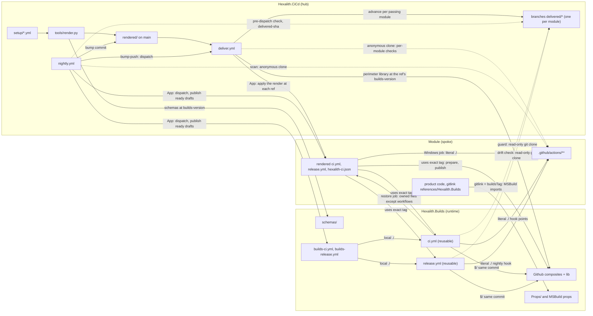
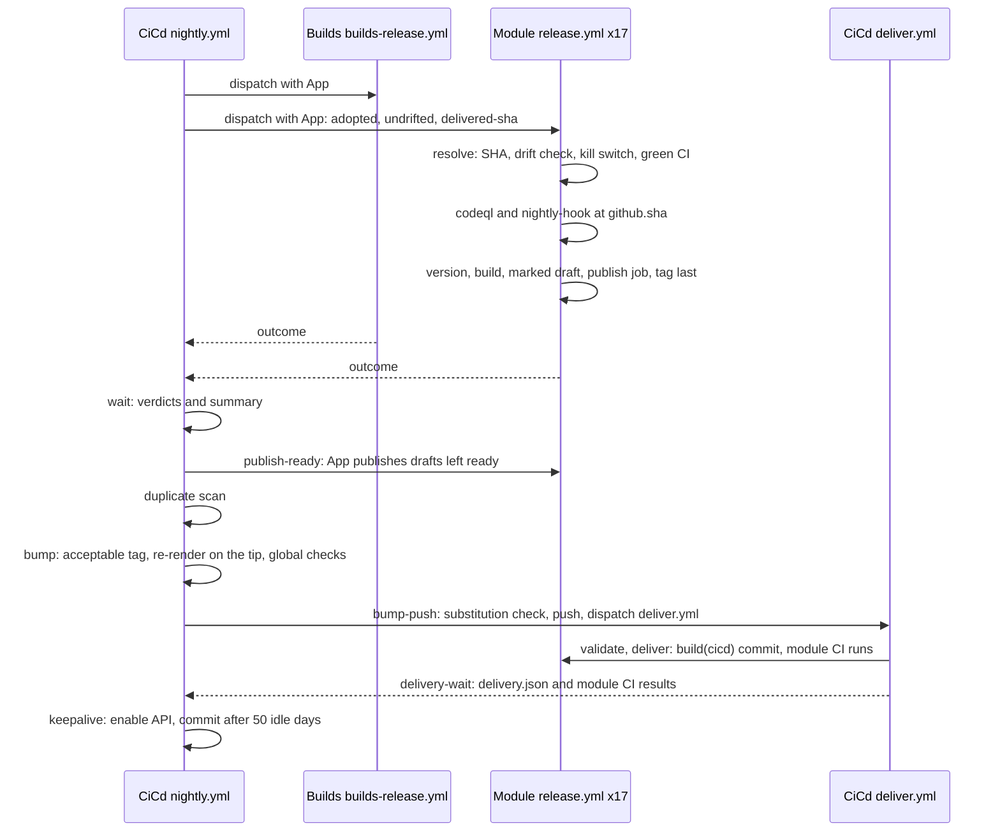
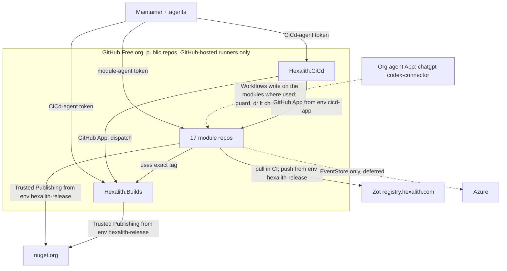

# Architecture Spine — Hexalith.CiCd

## Precedence

SPEC-cicd decides *what*: capabilities, success criteria and constraints. This spine decides *how*. `stories.yaml` decides *who* builds each part and in what order. Its order must satisfy the ordering conditions in the ADs, which name conditions, not story numbers. Where the spec or a story's text conflicts with an AD on how something is built, build to the AD and raise the conflict as an architecture or spec update.

## Design Paradigm

**Hub-and-spoke desired-state reconciliation.** Hexalith.CiCd holds the desired state of every module's CI/CD and is the only writer of it into modules. Hexalith.Builds is the shared, module-agnostic runtime, consumed only by exact release tag. It is not a spoke (AD-19). Modules run what is committed in them, and the guard reconciles drift back to the last validated desired state.

| Role | Unit | Lives in |
| --- | --- | --- |
| Desired state (input) | per-module setup file | CiCd `setup/<Repo>.yml` |
| Desired state (output) | rendered owned files + perimeter | CiCd `rendered/<Repo>/…`, `rendered/<Repo>.perimeter.json`; validated copy per module on branch `delivered/<Repo>` |
| Controller | validate + deliver, nightly scheduler, duplicate scan | CiCd `tools/*.py`, `.github/workflows/` |
| Shared runtime | reusable CI and release workflows, composites, guard, perimeter library, local check, schemas, MSBuild props | Builds |
| Spoke (×17) | rendered callers + config, module-owned custom actions, product | each module repo |

## Invariants & Rules



These arrows are the allowed dependencies. Builds never names a module, module files never name CiCd, and custom actions never call Builds.

### AD-1 — CI is materialized in the module's commit

- **Binds:** CAP-1, CAP-2, CAP-3, CAP-5, CAP-12
- **Prevents:** a SHA's CI or release result depending on CiCd's state at run time
- **Rule:**
  - A module's CI/CD configuration is the rendered `.github/hexalith-ci.json`: `schema`, `buildsTag`, `solution`, `dapr`, `browsers`, `registry`, `codeql`, `tests`, `hooks` and `jobs`.
  - Builds' CI, Builds' release and `check.py` read it from the checkout, through the AD-4 loader.
  - It is complete: every knob is written out, so no reader applies a default or accepts a missing key.
  - The rendered callers carry only what `uses:` and job structure need: the Builds tag, triggers, permissions, concurrency, `cache-mode`, the secrets passed by name, the Windows jobs (which take `solution` from the `ci` job's output, AD-12) and the publish job with its environment.
  - At run time Builds reads CiCd only for the guard and the release drift check (AD-8, AD-17).

### AD-2 — Builds is module-agnostic

- **Binds:** CAP-1, CAP-2, CAP-5, CAP-15
- **Prevents:** per-module branches in shared CI/CD code that only one module exercises
- **Rule:** Builds' new pipeline code (workflows, composites and scripts) contains no module names, lists or module-specific conditions. All variation comes from `hexalith-ci.json` and the perimeter. The frozen legacy files (AD-20), the package catalog in `Props/` and its validators (AD-11) are outside this rule. Detecting Builds' own repository (AD-19) is not a module condition.

### AD-3 — Setup files are the module registry and the only per-module input

- **Binds:** CAP-4, CAP-9, CAP-13, CAP-16; render, deliver, nightly, duplicate scan
- **Prevents:** divergent module lists; free-form knobs; overrides that silently never apply; one module's state blocking all others; setup values rewriting the YAML they are rendered into
- **Rule:**
  - The managed modules are exactly `setup/*.yml` (file name = repo name), and every CiCd tool enumerates them. `setup/Hexalith.Builds.yml` is rejected (AD-19).
  - A setup file is `hexalith-ci.json` without `schema` and `buildsTag`; a setup file that contains either key fails.
  - The render adds `schema` (the `const` of the schema file at `builds-version`) and `buildsTag` (from `builds-version` only), and writes every knob explicitly: schema `default` values, plus the `codeql` rule below.
  - Validation checks that rendered `hexalith-ci.json` against Builds' `schemas/hexalith.ci.v<N>.json` at `builds-version`, never the raw setup file. Unknown keys fail.
  - The schema constrains every string a template writes into YAML: hook, job and action names match `^[a-z0-9]+(-[a-z0-9]+)*$`, job names exclude `ci`, the runner is `windows-latest`, and paths contain no control character and no `${{`. With `solution: none`, `jobs`, `hooks` and `tests` are empty, and `dapr` and `browsers` are `false`.
  - **Knobs:**
    - `solution`: a repo-relative path, or `none`, which runs stage 1 only and releases a GitHub release only.
    - `dapr`, `browsers`, `registry`.
    - `codeql`: languages, never `actions`. The default is `[csharp]`, or `[]` with `solution: none`. `[]` skips analysis.
    - `tests.integration`, `tests.exclude`, `hooks`, `jobs`.
  - Adding an optional knob with a schema default is a minor Builds release (AD-10).
  - **Global checks**, which gate every ref advance: render with no diff; schemas; tool tests; actionlint and zizmor over CiCd's workflows and, passed by path, `rendered/*/.github/workflows/*.yml`; `builds-version` names an acceptable tag (AD-10). They are one CiCd script, which `validate` and the nightly `bump` run identically, with no secret other than the job's read-only `GITHUB_TOKEN`.
  - **Per-module checks**, which gate only that module's `delivered/<Repo>` ref:
    - with anonymous reads, in every run: the repo is a submodule; every action named by `hooks`, `jobs` or `tests.exclude` exists on the module's live `main`; no job name equals a hook name; every `tests.exclude` target is an enabled hook or job;
    - with the App, in `main` runs only (AD-6), exactly these: the repo is in the App installation; its rulesets' targets, conditions and rules are exactly the AD-21 ones; code-scanning default setup and Dependabot security updates are off; its artifact and log retention is 90 days.

    Every other AD-21 precondition, including the rulesets' bypass actors (which the App can't read), is checked by hand at onboarding, never by delivery.
  - CiCd tools read module content from anonymous shallow clones of the module's live `main`, never from CiCd's submodule checkouts.

### AD-4 — Owned perimeter per module

- **Binds:** CAP-1, CAP-8, CAP-11, CAP-16; render, guard, restore, deliver
- **Prevents:** guard, restore and delivery disagreeing on what is owned or how it is compared; a schema change breaking pinned guards; readers accepting different documents; a broken owned file blocking its own repair; drifting copies of shared tool config; false drift from line endings, sparse clones or glob dialects
- **Rule:**
  - The render emits `rendered/<Repo>.perimeter.json`, validated by `schemas/hexalith.perimeter.v1.json` (Builds public API, document `schema: "hexalith.perimeter.v1"`).
  - **Closed entry kinds:** `whole`, `whole-dir`, `gitlink`, `gitmodules-section`, `json-superset`, `marker-block`, `absent-glob`, `absent-json`, `absent-line`.
  - Partial-entry text is inline. Whole-file content is `rendered/<Repo>/<path>`.
  - **One loader per document.** Builds' `Github/lib/` holds one stdlib loader each for `hexalith-ci.json` and the perimeter. Every reader uses it: CI, the release, the guard, restore, `check.py`, and delivery through its Builds clone.
    - It accepts exactly the `schema` value of the schema file at its own commit, and rejects unknown and missing keys.
    - An unknown `schema` value or entry kind fails with its fixed message.
    - `builds-ci.yml` runs the loaders and the JSON Schemas over the same valid and invalid fixtures.
  - **Repair comes before parsing.**
    - The guard compares the module's owned files with the expected state before anything parses the module's copy.
    - `check.py` compares the `HEAD` gitlink with the checked-out submodule commit first, which needs no JSON.
    - A module copy that can't be read, or that has an unknown `schema`, is drift: the ownership message, then restore.
    - Restore and delivery never parse the module's copy of a whole-file entry. They compare blobs and overwrite. A partial-entry file that can't be parsed is drift, and is rewritten holding only the owned part.
  - **One perimeter library** in Builds compares and applies entries. The guard, restore and delivery all use it, and Builds hard-codes no path list.
    - It enumerates and reads paths from git (the `HEAD` tree or the index), never from the working tree.
    - Globs are git wildmatch on repo-relative paths: `*` stops at `/`, and only `**/` crosses directories.

  | Path | Kind |
  | --- | --- |
  | `.github/workflows/` | `whole-dir`: an unrendered file is drift |
  | `.github/hexalith-ci.json`, `.github/dependabot.yml` | `whole` |
  | `references/Hexalith.Builds` | `gitlink` = `buildsTag`, resolved with `^{}` |
  | the `.gitmodules` section whose `path` is `references/Hexalith.Builds` | `gitmodules-section`: identified by `path`; owns `path` and `url` only, with no `branch` or `update`; keeps the existing section name (default `references/Hexalith.Builds`) and removes any other section with that path |
  | `.claude/settings.json` `permissions.deny` | `json-superset`; every other key is module-owned |
  | `AGENTS.md`, `CLAUDE.md`, `.github/copilot-instructions.md` | `marker-block` between `<!-- hexalith-cicd:begin -->` and `<!-- hexalith-cicd:end -->` |
  | `.releaserc*`, `release.config.*`, `commitlint.config.*`, `.commitlintrc*`, `**/Directory.Build.rsp`, `**/bmad-testarch-ci/**` | `absent-glob` |
  | `release`/`commitlint` keys and `semantic-release`/`@commitlint/*` dependencies in `package.json` | `absent-json` |
  | commitlint in `.husky/commit-msg` | `absent-line` |
  | `.github/actions/**` | module-owned: linted and scanned, never restored |

  - Every entry is judged on blob content read from git.
    - Whole files are compared as blobs. The render writes LF, UTF-8 without BOM, and a final newline.
    - Partial entries are judged semantically after CRLF is normalized to LF, and edited minimally, only when the check fails. A `json-superset`, `marker-block` or `gitmodules-section` entry whose file is missing creates it, holding only the owned part. An `absent-*` entry on a missing file is met.
    - The library writes only to the index, never through the working tree: blobs with `git hash-object -w --path=<path>`, so the module's attributes apply; entries with `git update-index --add --cacheinfo` (mode `160000` for the gitlink); deletions with `git rm --cached --sparse`.
  - semantic-release, its plugins and commitlint, with their config and npm pins, exist only in Builds.

### AD-5 — Rendering is committed with its cause

- **Binds:** CAP-4, CAP-6
- **Prevents:** setup and rendered output drifting apart in CiCd; bot commits racing authors; a render that changes with module state
- **Rule:**
  - `render.py` reads only `setup/`, `templates/`, `builds-version` and Builds at `builds-version`. Templates emit every value through a `tojson` filter, with `StrictUndefined`.
  - Whoever changes `setup/`, `templates/`, `builds-version` or `builds-skip` runs the render and commits the change together with `rendered/`. This includes the nightly bump and every rollback.
  - The global checks re-render and fail on any diff.
  - The only automated CiCd commits are the nightly bump and the keepalive (AD-18).

### AD-6 — One write path into modules

- **Binds:** CAP-4, CAP-6, CAP-8, CAP-11, CAP-16
- **Prevents:** several writers pushing conflicting owned-file states; unvalidated renders reaching modules or the guard; a skipped module receiving its rejected render through the guard or restore; stale renders written back after a race or a re-run; drift persisting in a skipped module or while CiCd `main` is broken; validate-only runs cancelling deliveries
- **Rule:**
  - CiCd `deliver.yml` is the only writer of owned files into modules. The one exception is the AD-8 restore job.
  - `deliver.yml` is a top-level workflow with two jobs:
    - `validate`, with no secrets: the global checks and the anonymous per-module checks (AD-3). It outputs one JSON object: the global-check verdict and the names of the modules that passed.
    - `deliver`, on `main` only, after `validate` whatever its result, in environment `cicd-app` (AD-7). It treats a missing `validate` output as a failed global check, and accepts only module names in `setup/*.yml`.
  - **Triggers:** push to `main`, `pull_request`, hourly at minute 47, manual dispatch.
  - **Concurrency:** runs on `main` use the group `deliver` and are never cancelled. Other runs use `deliver-validate-<ref>` and cancel in progress.
  - **The `deliver` job:**
    1. Run the App per-module checks (AD-3).
    2. If the global checks passed, then for each module that passes all its checks, advance CiCd branch `delivered/<Repo>` to the validated commit with an App token holding Contents and Workflows write on CiCd, provided that commit equals or descends from the ref. Otherwise report "superseded by `<sha>`". A ref never moves backwards, and a module that fails its checks keeps its ref.
    3. For every module that has a `delivered/<Repo>` ref, passing or not, take a shallow sparse clone of the module's live `main` and apply the render at that ref (perimeter and files) with Builds' perimeter library. Before cloning Builds at that ref's `builds-version`, confirm with stdlib API reads that it is an acceptable tag (AD-10), and check the clone's commit against the tag.
    4. If there is no diff, push nothing. Otherwise push one `build(cicd): …` commit with an App token.
    5. If the push is not a fast-forward, re-fetch and re-apply (at most 3 times). Never rebase, never force-push.
  - When the run's global checks failed, steps 1 and 2 are skipped, and steps 3–5 run with `tools/` taken from the newest commit that a `delivered/*` ref on `main` points to, never from the run's commit.
  - The `deliver` job uploads the artifact `hexalith-delivery` (one `delivery.json`): per module, the ref commit and the pushed module commit, or `unchanged`, `superseded` or `failed`.
  - A module with no ref yet gets nothing. A ref whose commit is not an ancestor of CiCd `main` fails the run, naming it; it is not applied, and its commit is never the `tools/` source. A failed global check, a module that fails its checks, or a failed push is reported, and the run fails.
  - Delivery starts only once `builds-version` names a tag that ships the perimeter schema and library (AD-10).
  - Once `nightly.yml` has run at least once, the hourly run also fails if the last `nightly.yml` run is more than 26 hours old.

### AD-7 — Credentials

- **Binds:** CAP-7, CAP-8, CAP-12, CAP-13; every CiCd workflow
- **Prevents:** unattended paths dying on token expiry; module runs or agents holding cross-repo write power; agents bypassing CiCd through its own repos; the App key or the publish credentials being reachable from a branch or from third-party code
- **Rule:**
  - **The App.** One org-owned GitHub App has Contents, Workflows and Actions read & write, and Administration and Code scanning alerts read. It is installed on selected repos: the 17 modules, Builds and CiCd. Preconditions it can't read are a manual checklist (AD-21).
  - **The key.** It exists only as a secret of the CiCd environment `cicd-app`. Only `deliver.yml`'s `deliver` job and `nightly.yml`'s App jobs reference that environment.
    - A job in `cicd-app` runs only stdlib Python (`python3 -I`) from CiCd's `tools/` and from Builds at an acceptable tag, git, and SHA-pinned actions, and parses only JSON. Render, validation, tests, linting and the scan run in jobs with no secrets.
    - Each job mints its own tokens with `actions/create-github-app-token`, passing `owner`, `repositories` and `permission-*` for each use. No token is used more than 50 minutes after it was minted. A job re-mints by running that action again as its own step (no CiCd script signs the App JWT), so a long wait alternates mint and poll steps.
    - The key is reachable by every CiCd Contents writer and every creator of an acceptable Builds tag: the org owners, CiCd-agent sessions and the CiCd App. This is accepted under the careless-agent model. It never enters a module.
  - **Environments.** `cicd-app` and each repo's `hexalith-release` have one protection rule: deployment branch `main`, with no required reviewers and no wait timer.
  - **Publish credentials.** Each managed repo's `hexalith-release` holds that module's own registry push pair, a Zot identity that can push only that module's repositories and is distinct from the legacy `HEXALITH_ZOT_*`. Only the publish job references it. After adoption, a module's only nuget.org Trusted Publishing policy is for `release.yml`, names `hexalith-release` and is scoped to the module's package-ID prefix (Builds from its rewrite, AD-19).
  - **Untrusted content in write jobs.** In `cicd-app` and restore jobs, git runs with no submodule recursion, `GIT_LFS_SKIP_SMUDGE=1` and `core.hooksPath=/dev/null`, and receives tokens only as a header scoped to `https://github.com/`. Artifacts and module JSON are read in memory with a size cap, never extracted. Each module is processed in isolation: one module's failure is reported without stopping the others.
  - **Module agents.** A fine-grained token on module repos only, with Contents and Pull requests write. It has no Workflows, Administration, Actions, Variables or Secrets write. Module agents start each branch from current `main`.
  - **CiCd agents.** A fine-grained token on Builds and CiCd only, with Contents, Workflows and Actions write, for interactive sessions only.
  - **App-based agents.** `claude`, `cursor` and `semgrep-app` are installed on no managed repo. `chatgpt-codex-connector` is installed only on the modules where it is used, never on CiCd or Builds; there it holds Workflows write that the org cannot remove. It can publish its own module's packages and containers through an edited workflow on `main`; this is accepted, limited to that module by the per-module scoping. The guard, nightly's pre-dispatch check (AD-18), the release drift check (AD-17) and hourly delivery repair the files.
  - Nothing unattended uses a personal token, and agent sessions never run with the maintainer's personal `gh` login.

### AD-8 — Guard and restore

- **Binds:** CAP-7, CAP-8, CAP-9, CAP-11, CAP-14
- **Prevents:** the guard enforcing an unvalidated render; custom actions holding write tokens or calling Builds; restore loops; restore splitting the lockstep set; module-owned audit or gate bypasses; module code or module config steering the guard or restore
- **Rule:**
  - The guard is stage 1 of every CI run. It reads the perimeter and expected files by anonymous shallow sparse git clone of its own module's CiCd branch `delivered/<Repo>`, never `main`, `raw.githubusercontent.com` or the REST contents API.
  - **It checks:**
    - the AD-4 perimeter;
    - that every enabled hook and job action exists, at the workspace root;
    - the custom-action deny list (`enforcement.md`), over every `action.yml` and `action.yaml` under `.github/actions/**`: each has `runs.using: composite`; each `uses:` names a directory under `.github/actions/` or a third-party action at a full commit SHA, never `Hexalith/Hexalith.Builds`. Any other local action path fails;
    - the audit lint, over every tracked file whose root element is an MSBuild `<Project>`, whatever its extension, plus `*.rsp` and NuGet config files matched case-insensitively: no NU1900, NU1903, NU1904 or NU1905 in a `NoWarn` element (under any parent) or attribute, no `NuGetAuditSuppress`, no `MSBuildWarningsAsMessages`, no `TreatAsLocalProperty` naming a `NuGetAudit*` property, no `auditSources`, and no `TestingPlatformCommandLineArguments` or `VSTestTestCaseFilter`;
    - commitlint (PR: base..head; push: before..after; dispatch: `HEAD`), run with `--config` from the guard's own action path. Commitlint is part of the guard composite; the reusable `ci.yml` has no other commitlint step.
  - A missing ref or perimeter fails the guard.
  - **PR:** fail with the diff and the ownership message.
  - **Push to `main`:** fail the same way. A separate `restore` job (`GITHUB_TOKEN`: `contents: write`, `actions: write`) applies the perimeter in one commit, then dispatches `ci.yml` on `main`.
    - It runs only Builds code at the workflow's own commit, with `python3 -I`. It recomputes the expected state from `delivered/<Repo>` and takes nothing from the CI job except its drift flag. It never runs when `module-root` is set.
    - It skips `.github/workflows/**`. It writes the gitlink and the `.gitmodules` section only when the perimeter's tag equals the running workflow's tag, and `hexalith-ci.json` only when, in addition, the module's `.github/workflows/` already equals the delivered render. The running tag comes from the workflow's own ref (`job.workflow_ref`), never from the module's `hexalith-ci.json`.
    - On a non-fast-forward it stops; the newer commit's own CI takes over.
  - **`workflow_dispatch`:** check only, never restore.
  - What restore skips waits for the next delivery, at most one hour later (AD-6 re-applies every delivered module).
  - The CI build job has `contents: read`.

### AD-9 — Builds code runs from the workflow's own commit

- **Binds:** CAP-1, CAP-3, CAP-6, CAP-8
- **Prevents:** a re-pinned Builds pointer running an older guard that approves its own downgrade; two Builds versions in one run
- **Rule:**
  - Builds reusable workflows reference their own composites with `$/…`, and scripts resolve via `GITHUB_ACTION_PATH`.
  - Callers reference Builds composites (`prepare`, `publish`) at the same exact tag as the workflows.
  - The module's `references/Hexalith.Builds` is data only: MSBuild props and the local check.
  - Fallback if `$/` fails: Builds checks itself out at `job.workflow_sha`, the commit of the running reusable workflow.

### AD-10 — Builds versioning and lockstep

- **Binds:** CAP-5, CAP-6, CAP-15, CAP-16
- **Prevents:** modules on different Builds versions; auto-bumps to an interface the render doesn't match; rollbacks undone overnight; central package changes that never release; waivers spread across modules; an unvetted tag reaching every module; a minor breaking custom actions or module imports
- **Rule:**
  - **Public API (semver).** Builds' public API is:
    - the reusable workflows' `workflow_call` inputs, secrets and outputs (including `ci.yml`'s `solution` output and `release.yml`'s `delivered-sha` input), and the caller permissions they require;
    - the `prepare` and `publish` composite interfaces;
    - the AD-14 hook and job contract: hook names, the action path, the inputs and environment passed, and the workspace guarantees;
    - `schemas/hexalith.ci.v1.json`, `schemas/hexalith.perimeter.v1.json` and `schemas/hexalith.release-outcome.v1.json`;
    - the `check.py` command line;
    - the MSBuild property names Builds reads or passes (`UseHexalithProjectReferences`, which modules define, and `HexalithPublishContainer`), the MSBuild files modules import (`Hexalith.Build.props`, `Hexalith.Package.props`, `Props/Directory.Packages.props`) and the `PackageVersion` set. Removing or renaming any of them is a major.

    The test-only inputs `module-root` and `expected-source` are outside it. The global checks validate rendered callers, `hexalith-ci.json` and perimeters against `builds-version`.
  - **API check.** `builds-ci.yml` compares the public API with the last release tag: `workflow_call` inputs, secrets and outputs; composite inputs; schema files; imported MSBuild files; the `PackageVersion` set. It fails a change that removes or renames any of them unless its commits carry a breaking-change marker.
  - **Schema versions.**
    - Each Builds tag ships at most one version of each of those three schemas. Adding a schema that no earlier tag shipped is a minor.
    - `hexalith.ci` may gain an optional knob in a minor.
    - A new perimeter entry kind or field, or any removal or change of meaning in any of the three, is `v<N+1>` and a Builds major.
    - The render and validation take the schema file name and `schema` value from Builds at `builds-version`.
  - **Lockstep.** Modules reference Builds only by exact release tag, in callers, `hexalith-ci.json` and the gitlink, all moved together by delivery.
  - **Acceptable tag.** A Builds tag is acceptable only if its GitHub release is published and immutable, authored by `github-actions[bot]`, and its commit is an ancestor of Builds `main`.
  - **Auto-bump.** The nightly auto-bump moves `builds-version` to the newest acceptable tag in the current major that is not in `builds-skip`.
    - A new major is adopted by one CiCd commit that changes `builds-version`, `templates/` and `setup/` together.
    - A rollback sets `builds-version` to the older tag, adds the bad tag to `builds-skip`, and removes setup keys that the older schema lacks. A rollback across a major reverts that major's adoption commit.
  - **Release rules.**
    - Builds releases on every commit type except `docs`, `test` and `style`, and has no prerelease channel.
    - In modules, `feat`, `fix` and `perf` release; `build`, `ci` and `build(deps)` don't; `fix(deps)` does.
  - **Audit waivers.** NuGet audit waivers (`NuGetAuditSuppress`) exist only in Builds `Props/`, and only CiCd agents change them.
  - **Dependabot.** Module `dependabot.yml` never enables `github-actions` or `gitsubmodule`, and uses the prefix `build(deps)`.

### AD-11 — One language, scripts only

- **Binds:** all Builds and CiCd logic; CAP-3
- **Prevents:** logic spread across languages; untested inline YAML logic; CI and the local check running different code; floating or tampered tools
- **Rule:**
  - All logic is Python ≥ 3.12. Builds' own CI runs the script tests on 3.12 (`actions/setup-python`) and on the runner's `python3`.
  - Builds runtime scripts use the standard library only.
  - CiCd tools that run in a `cicd-app` job, or that push, use the standard library only and run with `python3 -I`. The other CiCd tools (render, validation, scan) declare PEP 723 inline dependencies, are locked with `uv lock --script` (the lock files are committed), and run with `uv run --locked`.
  - Third-party tools are called from scripts and pinned by version and integrity, in Builds or CiCd:
    - npm tools through a committed lockfile, `npm ci --ignore-scripts`, then `npm audit signatures`;
    - binaries that a Builds or CiCd script downloads itself, through a SHA-256 it checks before use. Tool-managed downloads (Playwright browsers, the Dapr runtime) are pinned by the tool's version.
  - The parts of `prepare` that run on Windows (checkout, .NET setup, restore, build) contain no Python and read no JSON.
  - A workflow `run:` step only invokes a script, except for one-liners. Expressions never appear inside `run:`; values reach scripts through `env:`.
  - Custom actions are module-owned and not bound by this rule.
  - The `Props/` catalog validators in Builds' `Tools/` are product checks, as in AD-2's `Props/` exception. Each is classified with the gate rule (`gate-classification.md`); the ones kept run in `builds-ci.yml` in their current language.

### AD-12 — CI job shape

- **Binds:** CAP-2, CAP-5, CAP-10, CAP-14
- **Prevents:** late failure reporting; hooks or integration tests running after a unit failure; environment setup duplicated in custom actions; CI and the local check building differently; advisories turning CI red; a second reader of `hexalith-ci.json` on Windows
- **Rule:**
  - CI is one job, in this order:
    1. Guard, which includes commitlint.
    2. Restore, then a Release build in package mode without audit: `-warnaserror -p:UseHexalithProjectReferences=false -p:NuGetAudit=false`, plus the restore settings of the SDK convention.
    3. Unit tests, project by project, stopping at the first failing project (AD-13).
    4. Builds environment setup, run once:
       - Dapr if `dapr`, at the one Dapr version pinned in Builds;
       - browsers if `browsers`, or if stage 4 holds an E2E project;
       - registry login if `registry`, with the pull-only pair.

       Then hook `after-unit-tests`, then integration tests project by project, then hook `after-integration-tests`.
  - The environment setup is one Builds composite. CI stage 4 and `prepare` on Linux use it.
  - `solution: none` runs stage 1 only.
  - Only the Builds submodule is checked out.
  - No CodeQL runs on a push or PR.
  - The module `ci.yml` triggers on `push` to `main`, `pull_request` and `workflow_dispatch`.
  - A custom action that needs browsers or Dapr is a hook with that knob on.
  - `jobs` exist only for Windows. The reusable `ci.yml` outputs every knob that Windows `prepare` uses, as the loader validated it: `solution` (workspace-relative, including `module-root` when set) and, once added, `submodules`. Each job is rendered with `needs: ci`, `runs-on: windows-latest` and two steps: `uses: Hexalith/Hexalith.Builds/Github/prepare@<tag>` with those outputs as inputs, then a literal `uses: ./.github/actions/<job-name>`.
  - On Windows, `prepare` checks out, sets up .NET, restores and builds, and sets up no environment. On Linux, it reads the knobs through the AD-4 loader and runs the environment setup after the build.

### AD-13 — Test-stage classification

- **Binds:** CAP-2, CAP-3, CAP-10
- **Prevents:** silent test loss; gate erosion through module-owned skips; CI and the local check classifying differently
- **Rule:**
  - Test projects are the projects in `solution` whose MSBuild `IsTestProject` is `true`. There is never a file glob.
  - A project is identified by its repo-relative `.csproj` path, with forward slashes.
  - Default stage: a name ending in `IntegrationTests`, `Integration.Tests` or `AppHost.Tests`, or containing `E2E`, goes to stage 4. Everything else goes to stage 3.
  - The only overrides are `tests.integration` and `tests.exclude` (project → enabled hook or job). There is no plain skip.
  - Projects run in ordinal path order within a stage, each with `dotnet test --project <path>` when `global.json` selects Microsoft.Testing.Platform, positionally otherwise.
  - One classifier in Builds serves CI and the local check.

### AD-14 — Custom-action contract

- **Binds:** CAP-5, CAP-9, CAP-10
- **Prevents:** custom actions growing into a second pipeline; hooks with divergent shapes, permissions or secrets; two Builds versions in one run; a secret reaching every test in the CI job
- **Rule:**
  - Custom actions are composite only, at `.github/actions/<hook-name or job-name>/action.yml`, and always resolve from the workspace root.
  - The hooks are exactly `after-unit-tests`, `after-integration-tests` and `nightly`, with one action per hook point. That action may call local sub-actions.
  - An action may use any language. A hook action assumes a restored, Release-built workspace with the Builds environment set up; a Windows job's action assumes a restored, Release-built workspace only. No action rebuilds, sets up an environment or calls Builds.
  - It gets a read-only token. Every secret its job references is readable by all of that job's steps, so the CI job and `nightly-hook` hold only the pull-only registry pair. Hook secrets arrive as a minor Builds API change when the first hook that needs one is enabled, passed explicitly by name (Deferred: where they go).
  - Directories that are not enabled stay dormant: linted and scanned, never run.
  - Failure means a failed step. Actions write no result or evidence files.

### AD-15 — Local check mirrors CI stages 1–3

- **Binds:** CAP-3
- **Prevents:** a local pass followed by a CI fail on the same commit
- **Rule:**
  - `python3 references/Hexalith.Builds/check.py` first compares the `HEAD` gitlink with the checked-out submodule commit, without reading any JSON.
  - It then reads `.github/hexalith-ci.json` through the AD-4 loader and checks that both equal `buildsTag`. A missing `buildsTag` fails.
  - It then runs the same guard (commitlint over `origin/main..HEAD`), the same build flags and the same classified unit-test scripts as CI.
  - Hooks never run locally. There is no pre-push hook.

### AD-16 — The release SHA and its green CI

- **Binds:** CAP-12, CAP-13
- **Prevents:** releasing an untested commit; release and CI disagreeing about "green"; gates vouching for a different commit than the one shipped; pushes during the night changing what is released; a hand-made draft or tag steering a release
- **Rule:**
  - The `resolve` job of the reusable release fails unless `github.ref` is `refs/heads/main`. It resolves the release SHA once: the SHA of the marked draft if one exists (complete mode), otherwise `github.sha` of the dispatched run (create mode). It is never re-resolved, and more than one marked draft fails the run.
  - **Marked draft.** A draft is marked only if:
    - it was authored by `github-actions[bot]`;
    - its `target_commitish` equals its `hexalith-release:` trailer, and that SHA is an ancestor of `main`;
    - its `tag_name` is `v<semver>`, above the last `v*` tag other than its own `tag_name` reachable from that SHA.

    Every other draft is unmarked and never touched, except that a draft authored by `github-actions[bot]` whose body carries a `hexalith-release:` trailer but fails this test fails `resolve`, naming it.
  - **The last `v*` tag reachable from a SHA** is the highest `v<semver>` without a prerelease among the tags whose commit is an ancestor of that SHA. One Builds stdlib function computes it; `draft` outputs it as `last-tag`, `publish` takes it from there and nightly from `outcome.json`, and both re-check only ancestry. With no reachable `v*` tag, `version` ranges over the whole history and the only accepted version is `1.0.0`.
  - In create mode every gate and the build use the release SHA. In complete mode the gates ran in the run that created the draft (AD-17). `codeql` and `nightly-hook` always run at `github.sha`.
  - **Green CI** (create mode). The release reads, from the Actions API, the latest run of `ci.yml` for the release SHA with event `push` or `workflow_dispatch`. Only Builds passes another `ci-workflow` (`builds-ci.yml`); any other value fails.
    - Conclusion `success`: continue.
    - Anything else, or no run: fail with "main is red, nothing released".
    - In progress: wait up to 30 minutes, then decide.

### AD-17 — Release state machine

- **Binds:** CAP-12, CAP-13, CAP-14, CAP-16
- **Prevents:** partial releases needing recovery workflows; a version republished from different content; a stale draft blocking a module's releases; a release refused by GitHub or captured by a stray tag; a drifted caller shipping; module-owned audit bypasses; nuget.org rejecting logins from the shared workflow; module or third-party code holding write tokens, publish credentials or the outputs `publish` trusts; a poisoned cache reaching a package; an outcome that no job writes or two jobs write
- **Rule:**
  - **Module `release.yml`** (rendered, `workflow_dispatch` only, `cache-mode: none`) has two jobs:
    - `release`: `uses:` Builds' reusable `release.yml`, passing `delivered-sha` and the registry pull pair.
    - `publish`: `needs: release`, runs only if `publish == 'true'`, in environment `hexalith-release`, with `id-token: write`, `contents: write` and `actions: read`. Its one step is `uses: Hexalith/Hexalith.Builds/Github/publish@<tag>`.
  - **Reusable `release.yml`** (`cache-mode: none`). Every job declares `permissions:`, and the caller's `release` job grants their union (AD-10 caller permissions). The jobs that run module or third-party code (`codeql`, `nightly-hook`, `version`, `build`) get `contents: read`, no secret except `nightly-hook`'s pull pair, and `persist-credentials: false`.
    1. **`resolve`** (stdlib only; `contents: write`, which listing drafts needs, and `actions: read`):
       1. Resolve the release SHA and the mode (AD-16).
       2. Create mode: run the AD-4 perimeter comparison (the drift check only) on the release SHA against `delivered-sha`. The input is accepted only if it is the live `delivered/<Repo>` commit or one of its ancestors, fetched by branch, never by bare SHA; the live ref is used when it is absent. Drift fails red.
       3. Kill switch. `HEXALITH_RELEASE_PUBLISH_ENABLED` exactly `false` ends the run with "publishing disabled", creating or completing nothing. Exactly `true` continues. Any other value, including unset, fails red.
       4. Create mode: green CI (AD-16).
    2. **`codeql`** (a matrix over the `codeql` languages) and **`nightly-hook`** (AD-18) run at `github.sha`, whatever the kill switch says. The jobs below run only when `resolve` succeeded with the kill switch `true`, and `codeql` and `nightly-hook` each succeeded or were skipped.
    3. **Create mode:**
       - `version` computes the next version with `@semantic-release/commit-analyzer` and `@semantic-release/release-notes-generator` over `<last v* tag reachable from the SHA>..<SHA>`; semantic-release core is not run. Nothing found: "nothing to release".
       - `build` builds and packs once at the release SHA with `-warnaserror:NU1900;NU1903;NU1904;NU1905 -p:NuGetAudit=true -p:NuGetAuditMode=all -p:NuGetAuditLevel=low` and the restore settings of the SDK convention, and builds containers as OCI archives. An audit failure fails with "vX.Y.Z blocked by a vulnerable package". It uploads the artifact `release` (`packages/*.nupkg`, `containers/*.tar`, kept 90 days) and outputs only its artifact ID and digest.
       - `draft` (stdlib only, `contents: write`):
         - accepts `version` only if it is the last reachable `v*` tag with exactly one of major, minor or patch incremented (lower parts zeroed);
         - checks through the API that the artifact ID belongs to this run, is named `release` and has the digest `build` output;
         - lists drafts again: it reuses a marked draft whose `hexalith-release-run:` names this run, and fails if any other marked draft exists;
         - if the release SHA's `.github/workflows/` differs from `main`'s, creates nothing and fails with "workflows changed on main during the release, nothing released";
         - otherwise creates the marked draft: `tag_name` `v<version>`, `target_commitish` the full release SHA, and a body holding the notes and the trailers `hexalith-release: <sha>`, `hexalith-release-run: <run-id>`, `hexalith-release-artifact: <id> <sha256>`, `hexalith-release-packages: <ids>` and `hexalith-release-containers: <names>`.
    4. **Complete mode:**
       - `draft` (stdlib only) takes exactly the artifact named by `hexalith-release-artifact:`, from the run named by `hexalith-release-run:`. It first checks that that run's workflow path equals the running caller's (`github.workflow_ref`: `release.yml` in modules, `builds-release.yml` in Builds), and that it was a `workflow_dispatch` run on `main` at the draft's SHA. A run that no longer exists or fails this check counts as having no artifact; an artifact whose API digest differs fails the run.
       - Nothing is drift-checked, CI-checked, loaded from `hexalith-ci.json` at the draft's SHA, or built.
       - Without the artifact, the draft is deleted only when none of its listed packages exists at its version on nuget.org and none of its listed container tags exists in the registry (any answer other than a definite not-found counts as existing); the run then ends `nothing`. Otherwise it fails with "draft vX.Y.Z cannot be completed: its build artifact is gone".
    5. `draft` outputs `publish`, `version`, `sha`, `last-tag`, `draft-id`, `artifact-id`, `artifact-digest` and `artifact-run`.
  - **`publish` composite.** It takes those outputs plus the NuGet user and the registry push pair. It runs only stdlib Python, `dotnet nuget push`, the container push tool and SHA-pinned actions, and never checks out the repo.
    1. Download the artifact by ID from `artifact-run`, outside the working directory. Check its digest, each `.nupkg`'s version and repository commit against `version` and `sha`, that the draft is still marked, and that no tag `v<version>` exists or that it points at `sha`.
    2. `NuGet/login` (Trusted Publishing).
    3. `dotnet nuget push --skip-duplicate`, from an empty directory, naming the source by its full URL.
    4. Push the containers by version tag.
    5. If the release SHA's `.github/workflows/` equals `main`'s, publish the draft, setting `tag_name`, `target_commitish` and `draft: false` in one request. That creates `v<version>` last. Then check the returned release and that `v<version>` resolves to `sha`, or fail with "tag vX.Y.Z does not point at the built commit". Otherwise end `ready`: `GITHUB_TOKEN` can't publish it, and nightly's `publish-ready` does, with the same checks (AD-18). In complete mode after a bump, this is the normal path.
  - **What is published:**
    - packages: the `IsPackable=true` projects in the solution;
    - containers: projects with `HexalithPublishContainer=true` that are not test projects.
  - **Outcome.** Each run writes the artifact `hexalith-release-outcome` once, from its last job, with `overwrite: true`. It holds `outcome.json`, validated by `schemas/hexalith.release-outcome.v1.json`: `schema`, `sha`, `version` when known, `outcome`, and for `ready` also `draftId` and `lastTag`.
    - The `publish` composite writes `published`, `ready` (publication left to `publish-ready`) or `failed`.
    - When `publish` does not run, a final `if: always()` job of the reusable release writes `nothing` (which covers a deleted stale draft), `disabled` or `failed`.

    The outcome is `failed` whenever any job of the run failed. It is `disabled` only when the kill switch is `false` and `codeql` and `nightly-hook` succeeded or were skipped.
  - No cache reaches the release: besides `cache-mode: none`, Builds workflows set `package-manager-cache: false` on setup-node and `enable-cache: false` on setup-uv, and the release restores no NuGet cache.
  - The release never commits to `main`. Unmarked drafts are never touched.

### AD-18 — Nightly orchestration

- **Binds:** CAP-6, CAP-9, CAP-13, CAP-14, CAP-15
- **Prevents:** a bump moving heads under queued releases; one failure blocking the bump; silent nightly failures; a disabled or dropped scheduler; legacy workflows dispatched by mistake; a drifted caller released; stale CodeQL alerts blocking releases; tokens expiring mid-run; a bad Builds minor halting all delivery or surfacing a day late
- **Rule:**
  - `nightly.yml` runs at 02:17 UTC as the jobs below. A job that uses the App runs in `cicd-app` and mints its own tokens (AD-7). Every job stays under the 6-hour job limit.
    1. **`dispatch`** (App).
       - It first waits, for at most 30 minutes, until no `deliver.yml` run on `main` is in progress or pending.
       - A module is **adopted** when `delivered/<Repo>` exists and its live `main` has `.github/hexalith-ci.json`. A module with the ref and no file has a failed adoption push, and fails the night. An adopted module with immutable releases off fails the night.
       - Each adopted module whose live `ci.yml` and `release.yml` equal those at `delivered/<Repo>` gets its `release.yml` dispatched, with `delivered-sha` set to that ref's commit. A drifted module is not dispatched, and fails the night.
       - Builds' `builds-release.yml` is dispatched too.
    2. **`wait`** (App). Polls every 60 seconds until all runs complete, for at most 5 hours, and outputs each run's conclusion and outcome. It fails only when it can't list the runs.
    3. **`publish-ready`** (App, stdlib only), after `wait` whatever its result.
       - For each run whose conclusion is `success` and outcome `ready`, it reads the draft by the outcome's `draftId` and checks that it is still marked, against the outcome's `lastTag`. It checks that the API digest of the artifact named by `hexalith-release-artifact:`, in the run named by `hexalith-release-run:`, equals the trailer, and that no tag `v<version>` exists or that it points at `sha`. It then sends `publish` step 5's publishing request, without its tree comparison, and checks the returned release and that `v<version>` resolves to `sha`. Its tokens hold Contents and Workflows write and Actions read on that repo.
       - It then writes the summary and the verdict per run: a conclusion other than `success` is failed, whatever the outcome; `success` with `published`, `nothing` or `disabled` passes; `ready` passes only if this job published that draft; no readable outcome, or still running after 5 hours, is failed. It fails if any verdict is failed.
    4. **`scan`** (no secrets), after `publish-ready` whatever its result: the duplicate scan, running jscpd with CiCd's committed config and never a config from the scanned module.
    5. **`bump`** (no secrets other than a read-only `GITHUB_TOKEN`), after `publish-ready` and `scan` whatever their results. It fetches the current tip of CiCd `main`, never the run's `github.sha`. On that tip it moves `builds-version` (AD-10), re-renders, and runs the AD-3 global checks. If they fail, nothing is pushed and the night fails, naming the tag. If nothing changes, the later bump jobs do nothing. It outputs the commit as an artifact ID.
    6. **`bump-push`** (stdlib only, `GITHUB_TOKEN` with `contents: write` and `actions: write`). It takes the commit by that artifact ID and pushes it as `build(cicd): bump Builds to vX.Y.Z`, only if:
       - its parent is the tip `bump` used, and that tip is still `main`;
       - its own API reads confirm that the new `builds-version` is the newest acceptable tag in the current major, not in `builds-skip`;
       - every changed file is `builds-version` or under `rendered/`, and each changed file under `rendered/` equals its parent copy with the old tag and its commit replaced by the new tag and its commit. The one exception: a `hexalith-ci.json` may also gain keys whose values equal the `default` in the new tag's `schemas/hexalith.ci.v<N>.json`.

       Any other difference, or a non-fast-forward, fails the night, naming the file; the next night retries. After the push it dispatches `deliver.yml` on `main`.
    7. **`delivery-wait`** (App), for at most 90 minutes:
       - it waits for the first `deliver.yml` run on `main` whose `deliver` job ran on the bump commit or a descendant (a cancelled run is not a result);
       - then, from that run's `delivery.json`, for each module it pushed to, the first completed, non-cancelled `ci.yml` run on `main` whose head is that commit or a descendant.

       Any of them that is not green fails the night.
    8. **`keepalive`** (`GITHUB_TOKEN`): calls the enable API for `nightly.yml` and `deliver.yml`. When CiCd's last commit is more than 50 days old, it commits `build(cicd): keepalive`.
  - The night fails when any job fails.
  - **Reusable `release.yml` jobs:**
    - `codeql`: when the `codeql` list is not empty, a matrix over its languages, with `build-mode: none` and category `hexalith-release/<language>`; otherwise skipped. It fails on open high or critical alerts whose most recent instance carries a `hexalith-release/` category.
    - `nightly-hook`: when enabled, Builds `prepare` (which sets up the environment on Linux, AD-12), then `./.github/actions/nightly`.
  - Modules have no `schedule:` triggers.



### AD-19 — Builds is the runtime, not a spoke

- **Binds:** CAP-1, CAP-6, CAP-15, CAP-16
- **Prevents:** delivery overwriting Builds' reusable workflows; no path to a first Builds tag; Builds' release never finding its CI or its config; a self-test that skips the guard, the hooks or the module imports; a guard on Builds tripping over the audit waivers it holds; the renamed release failing its own identity checks
- **Rule:**
  - Builds has no setup file. It is never rendered, delivered to, guarded against a `delivered/` ref, bumped or duplicate-scanned, and only CiCd agents change it.
  - Builds carries a hand-written `.github/hexalith-ci.json` in the same schema, describing its own solution, without `buildsTag`. `buildsTag` is optional in the schema, and every reader requires it outside Builds' own repository.
  - **Own CI.** `builds-ci.yml` (push to `main`, pull_request, workflow_dispatch) runs actionlint, zizmor and the Python tests. It also calls `./.github/workflows/ci.yml` twice:
    - against Builds itself, for the build and test stages;
    - against `Samples/Hexalith.Sample/`, with the test-only inputs `module-root` and `expected-source`.
      - Under `module-root`, `solution`, project paths, `hexalith-ci.json`, the perimeter and the owned paths resolve. Hook and job actions still resolve from the workspace root, so the sample's actions live in Builds' root `.github/actions/`, and only the `Samples/` call enables them.
      - `expected-source` names a directory laid out like a `delivered/<Repo>` tree for `Hexalith.Sample`.
      - The sample imports Builds through the same MSBuild files a module imports.
      - One Windows job, shaped like a rendered one, runs `prepare` on that call's outputs.

    No Builds test asserts workflow text.
  - **The guard in Builds.** In Builds' own repository, the guard and the release drift check run only when `module-root` is set, against the fixture perimeter. The `Samples/` call's commitlint covers Builds' own commit range. In any other repository, `module-root` and `expected-source` are rejected.
  - **Own release.** `builds-release.yml` is hand-written.
    - It first exists as the renamed legacy `build-release.yml`, with its publishing logic and legacy settings (`NUGET_USER`, environment `production`) unchanged. The same change repoints every hard-coded `build-release.yml` or `ci.yml` identity in Builds-only release tooling, including the green-CI check, to `builds-release.yml` or `builds-ci.yml`.
    - Before `nightly.yml` dispatches it, it is rewritten to mirror the module `release.yml`: it passes `ci-workflow: builds-ci.yml` and `release-rules: builds`, and its publish job runs in `hexalith-release` and publishes via `$/Github/publish`.
  - **Preconditions.**
    - Before any CiCd-agent change to Builds: the AD-21 rulesets (`main` and `v*` tags) are set; the org agent Apps exclude Builds (AD-7); the nuget.org policy names `builds-release.yml` with environment `production`, scoped to `Hexalith.Builds*`.
    - Before the first rewritten release, and checked again right before the bootstrap dispatch:
      - the App is installed;
      - `HEXALITH_RELEASE_PUBLISH_ENABLED` is exactly `true` or `false`;
      - Builds can read the org secrets and variables;
      - the `hexalith-release` environment holds Builds' push pair, and the nuget.org policy names it instead of `production`;
      - immutable releases are on, and the artifact and log retention is 90 days;
      - every Builds `v*` tag has a published release, or the tag is deleted.
  - **Bootstrap.** The first Builds release from the new pipeline is dispatched by hand, and its tag seeds `builds-version`. If it ends `ready`, the maintainer publishes that draft by hand after the `publish-ready` checks (AD-18). Any other dispatch outside nightly that ends `ready` waits for the next night's `publish-ready`.
  - `nightly.yml` dispatches `builds-release.yml` as its one fixed extra dispatch.

### AD-20 — Legacy freeze until the last module has moved

- **Binds:** CAP-1, CAP-15, CAP-16; Builds `.github/workflows/`, `Github/`, `Tools/`
- **Prevents:** rewriting Builds `main` and breaking modules that still call it at `@main` or a SHA; legacy files outliving the migration; commitlint running twice, or not at all, on Builds; a rename that turns Builds' own CI red; tests that assert workflow text surviving the migration
- **Rule:**
  - **Freeze.** Every Builds file that a module uses today stays unchanged until the last module has moved. That covers direct use (a `uses:` of a Builds workflow or composite, at `@main` or a SHA) and use through a Builds workflow. It includes `domain-ci.yml`, `domain-ci-v2.yml`, `domain-release.yml`, `codeql.yml`, `commitlint.yml`, `dependency-review.yml`, `Github/initialize-build`, `Github/initialize-dotnet` and `Github/verify`. Builds' own workflows may stop using a frozen file but never change it.
  - Until the final deletion, Builds' `dependabot.yml` excludes the frozen paths, and CiCd agents close Dependabot PRs that touch frozen files.
  - The freeze covers what modules execute, not tests. A change that renames or deletes a Builds-only workflow also deletes every test that asserts that workflow's text, including tests inside frozen directories, and repoints any other test that reads it by name.
  - The last module has moved when all 17 managed modules are adopted (AD-18).
  - New pipeline code lives in new files.
  - **Builds-only workflows are deleted in the change that ships their replacement:**
    - **The rename**, before the reusable `ci.yml` lands: `ci.yml` and `build-release.yml` become `builds-ci.yml` and `builds-release.yml`; `builds-ci.yml` stops calling `dependency-review.yml`; `eventstore-maintenance-publisher.yml`, which has no caller, is deleted.
    - `commitlint-caller.yml` is deleted in the change that makes the guard's commitlint run in `builds-ci.yml` (AD-19). It comes after the ruleset cut.
    - Every legacy job and step in `builds-ci.yml` (the G-4 and G-6 qualification jobs and tests, the `Require every validation job to pass` aggregator, and the `codeql.yml` call) leaves it in the change that rewrites `builds-release.yml`. The same change classifies the `Props/` catalog validators (AD-11).
  - **Final deletion.** After the last module has moved, the legacy deletion removes everything outside the end state, including `candidate-policy.yml` and the `domain-*.md` docs. Callers outside the 17 modules are not waited for. Known effect: the unmanaged repos that still run `Github/package-release@main` break on their next push.
  - **End state**, right after the final deletion:
    - `.github/workflows/` holds only `ci.yml`, `release.yml`, `builds-ci.yml`, `builds-release.yml` and `ci-cd-standards.md`;
    - `Github/` and `Tools/` hold only what those workflows and `check.py` use;
    - the root `package.json` carries no legacy release configuration.

    A workflow added later is a Builds API change (AD-10) and extends this list.

### AD-21 — Onboarding sequence

- **Binds:** CAP-4, CAP-7, CAP-10, CAP-12, CAP-16; every module onboarding
- **Prevents:** migrations that need the App key in an agent session; deliveries rejected by rulesets; modules adopted with settings that bypass the ADs; legacy state misleading the new release; legacy credentials outliving their users; a first release failing on a waiver its tag lacks
- **Rule:**
  - **Once, before the first adoption (maintainer):**
    - create the `HEXALITH_*` org secrets and variables. The pull pair is a pull-only Zot account, stored as both an Actions and a Dependabot org secret;
    - restrict the legacy org secrets (`NUGET_API_KEY`, `HEXALITH_ZOT_*`, `AZURE_*`, `SONAR_TOKEN`) to the repos that still read them, never CiCd or Builds;
    - set `claude`, `cursor` and `semgrep-app` to exclude every managed repo, and `chatgpt-codex-connector` to the modules where it is used (AD-7);
    - set the org's Actions artifact and log retention to 90 days, the public-repo maximum;
    - turn on secret-scanning push protection for CiCd, Builds and every module;
    - keep the org's default workflow permission at `read`, and require approval for fork PRs from all external contributors.
  1. **Maintainer preconditions, once per repo, in this order:**
     - add the repo to the App installation;
     - delete stale CodeQL configurations, unmarked drafts, and any draft or tag left by an incomplete legacy release;
     - set rulesets to exactly these, creating missing ones: `main` blocks deletion and force-push; `v*` tags block update and deletion. An orphan `v*` tag found later is deleted by the maintainer with that ruleset briefly disabled;
     - create the environment `hexalith-release` (AD-7) holding the module's own push pair, and add a nuget.org policy for `release.yml` naming it, scoped to the module's package-ID glob (for example `Hexalith.Commons*`), beside any existing policy;
     - turn off code-scanning default setup and Dependabot security updates;
     - set `HEXALITH_RELEASE_PUBLISH_ENABLED` to exactly `true` or `false`;
     - set the repo's Actions artifact and log retention to 90 days;
     - grant access to the org secrets and variables.
  2. **Module agents** prepare the product side with module-agent tokens:
     - custom actions;
     - deleting the gates and YAML-asserting tests the gate rule removes;
     - deleting module NuGet audit waivers;
     - deleting a root `package.json`, its `package-lock.json` and `.husky/` when they exist only for semantic-release or commitlint.

     They never touch owned files. A CiCd agent adds the module's waivers to Builds `Props/`, and adoption waits until `builds-version` names a tag that contains them.
  3. **A CiCd agent** adds the submodule, the setup file and the render in one CiCd commit. Delivery adopts the module once its per-module checks pass, in one `build(cicd): adopt Hexalith.CiCd` commit that replaces the perimeter and deletes the legacy workflows. The maintainer then, at once:
     - turns on immutable releases;
     - deletes every other nuget.org policy for the repo;
     - removes the repo from every legacy org secret, removes its package IDs from the legacy `NUGET_API_KEY` scope, and revokes the legacy Zot identity's push on its repositories.
  4. **Done** when the module's CI is green and its next nightly release succeeds, or reports nothing to release.

  **CiCd itself needs:**
  - the App, and the environment `cicd-app` (AD-7) holding `HEXALITH_CICD_APP_PRIVATE_KEY` and `HEXALITH_CICD_APP_CLIENT_ID`;
  - a ruleset that blocks deletion and force-push on `main`;
  - a ruleset on `delivered/**` that restricts creation, updates and deletion and blocks force-push, with the App as its only bypass actor;
  - CiCd and Builds with exactly the org owners as collaborators, no deploy keys, and no installation holding Contents, Workflows or single-file write except the CiCd App (AD-7).

## Consistency Conventions

| Concern | Convention |
| --- | --- |
| Workflow files | Module (rendered): `ci.yml`, `release.yml`. Builds: reusable `ci.yml`, `release.yml`; own `builds-ci.yml`, `builds-release.yml`. CiCd: `deliver.yml`, `nightly.yml`. |
| CiCd paths | `setup/Hexalith.<Name>.yml` → `rendered/Hexalith.<Name>/…` and `rendered/Hexalith.<Name>.perimeter.json`; `builds-version` holds one exact tag including `v`; `builds-skip` holds one tag per line; branches `delivered/Hexalith.<Name>`, one per module |
| Identifiers | projects: repo-relative `.csproj` path with `/`; hooks, jobs and actions in kebab-case (AD-3 pattern); job names never equal hook names; Builds' sample module: `Hexalith.Sample` |
| Schemas | New schemas follow Builds' convention: file `schemas/hexalith.<name>.v<N>.json`, JSON Schema draft 2020-12, `$id` `https://hexalith.com/schemas/<file>`, objects closed with `additionalProperties: false`; every document carries the required `schema: "hexalith.<name>.v<N>"`. Property names the schema defines are camelCase; keys that are data (project paths, hook and job names, foreign JSON keys) keep their own convention. |
| Commit types | Builds' commitlint config as it is today, plus one rule rejecting `[skip ci]`-family markers and `skip-checks` trailers: `type-enum` (build, ci, docs, feat, fix, perf, refactor, revert, style, test), header and body lines at most 200, footer lines at most 100 (config-conventional), merge commits linted (`defaultIgnores: false`); delivery and restore `build(cicd): …`; bump `build(cicd): bump Builds to vX.Y.Z`; keepalive `build(cicd): keepalive`; Dependabot `build(deps)` |
| Release markers | tags `v<version>`; draft `target_commitish` = the release SHA; draft body trailers `hexalith-release: <sha>`, `hexalith-release-run: <run-id>`, `hexalith-release-artifact: <id> <sha256>`, `hexalith-release-packages: <ids>` and `hexalith-release-containers: <names>`; CodeQL category `hexalith-release/<language>`; artifacts `release` (kept 90 days, the org retention), `hexalith-release-outcome` (one `outcome.json`) and, in CiCd, `hexalith-delivery` (one `delivery.json`) |
| Fixed messages | guard: "CI/CD is owned by Hexalith.CiCd. Fix the product code, not the pipeline." · loaders: "`<file>`: unsupported schema `<value>`. CI/CD is owned by Hexalith.CiCd." · "`<file>`: unsupported perimeter entry kind `<kind>`"; delivery: "superseded by `<sha>`"; release: "main is red, nothing released" · "nothing to release" · "publishing disabled" · "HEXALITH_RELEASE_PUBLISH_ENABLED must be exactly true or false" · "vX.Y.Z blocked by a vulnerable package" · "workflows changed on main during the release, nothing released" · "draft vX.Y.Z cannot be completed: its build artifact is gone" · "tag vX.Y.Z does not point at the built commit" |
| Secrets and variables | passed explicitly by name, never `secrets: inherit`. **Org**, restricted to the managed repos: `HEXALITH_NUGET_USER` (variable); `HEXALITH_REGISTRY_PULL_USERNAME`/`_PASSWORD` (Actions and Dependabot secrets; CI and `nightly-hook`). **Environment `hexalith-release`**, per repo: `HEXALITH_REGISTRY_USERNAME`/`_PASSWORD`, that repo's own Zot identity (publish job only). **Repo:** `HEXALITH_RELEASE_PUBLISH_ENABLED` (variable). **CiCd environment `cicd-app`:** `HEXALITH_CICD_APP_PRIVATE_KEY` (secret), `HEXALITH_CICD_APP_CLIENT_ID` (variable). |
| Workflow security | outside the AD-20 freeze: every workflow triggers only on `push`, `pull_request`, `schedule`, `workflow_dispatch` or `workflow_call`, and declares top-level `permissions: {}`, granting per job; both `release.yml` files and CiCd's `deliver.yml` and `nightly.yml` declare `cache-mode: none`, with setup-uv `enable-cache: false`; checkouts use `persist-credentials: false`, and a job that pushes passes its token explicitly; no expression inside `run:` |
| Concurrency | declared only in top-level workflows; module CI: `pull_request` runs in `ci-<ref>`, cancelling in progress, and push and dispatch runs in `ci-<sha>`, never superseded; `release` per repo; `deliver` for runs on `main`, never cancelled, and `deliver-validate-<ref>` for the others, cancelling in progress; `nightly` in CiCd; otherwise a pending run may be superseded by a newer one |
| Green | a workflow run with conclusion `success`; anything else is not green |
| Runners | `ubuntu-latest`; `windows-latest` for Windows jobs; GitHub-hosted only |
| Action references | `Hexalith/Hexalith.Builds/…@vX.Y.Z` (exact tag); third-party actions by full commit SHA with a `# vX.Y.Z` comment; Builds' own composites via `$/`; actionlint runs with ignores for `$/` references, the `job.workflow_*` properties and the `cache-mode` key; zizmor runs with a committed config (ref-pin `Hexalith/*`, hash-pin all others, `self-repository` audit off, never `--fix`) and its online audits, over Builds workflows and `Github/**/action.yml`, CiCd workflows and `rendered/**`; in Builds, the frozen legacy workflows (AD-20) are listed under per-rule `ignore` entries until the final deletion |
| SDK and build | SDK from the module's `global.json`, resolved by its `rollForward`; Release configuration; `-p:UseHexalithProjectReferences=false`, `-noAutoResponse` and `-p:RestoreConfigFile=<Builds' NuGet config>` everywhere, where that config maps every package to nuget.org, sets `signatureValidationMode` to `require` and trusts the nuget.org repository signature; `-p:NuGetAudit=false` in CI and the local check |
| Time | UTC everywhere; nightly 02:17; hourly delivery at minute 47; polling every 60 s; App tokens used at most 50 minutes after minting |

## Stack

| Name | Version |
| --- | --- |
| .NET SDK | per module `global.json` (10.0.403, most with `rollForward: latestPatch`); Builds 10.0.403 |
| Python | ≥ 3.12 floor (ubuntu-latest moving to 26.04: 3.14.4) |
| `actions/setup-python` (3.12 floor test) | v7.1.0 |
| uv | 0.13.7 |
| `astral-sh/setup-uv` | v10.3.3 |
| Jinja2 | 3.1.6 |
| PyYAML | 6.0.3 |
| jsonschema | 4.26.0 |
| Node.js / `actions/setup-node` | 24 (Maintenance LTS) / v7.1.0 |
| @semantic-release/commit-analyzer | 13.0.1 |
| @semantic-release/release-notes-generator | 14.1.1 |
| @commitlint/cli | 21.2.4 |
| @commitlint/config-conventional | 21.2.4 |
| jscpd | 5.4.3 |
| actionlint | v1.7.12 |
| zizmor | v1.32.0 |
| `actions/checkout` | v7.0.1 |
| `actions/setup-dotnet` | v6.1.0 |
| `actions/upload-artifact` | v7.0.2 |
| `actions/download-artifact` | v8.0.2 |
| `actions/create-github-app-token` (`client-id` input) | v3.3.0 |
| `github/codeql-action` | v4.39.3 |
| `NuGet/login` | v1.2.0 |
| Dapr runtime / CLI (one pin each in Builds `Props/`) | 1.19.1 / 1.19.1 |
| GitHub Actions runner (`$/` support) | ≥ 2.336.0 |

## Structural Seed



There are no runtime deployment environments (a spec non-goal); the two GitHub environments only gate credentials. Operations:
- **Failure signal:** `nightly.yml` goes red and GitHub's failure email goes to the last cron editor. Hourly delivery goes red if the nightly run stops.
- **Kill switch:** `HEXALITH_RELEASE_PUBLISH_ENABLED` per repo.
- **Rollback:** `builds-version` plus `builds-skip`.
- **Credentials:** the App key is rotated only on leak. The CiCd-agent and module-agent tokens are renewed at expiry (≤ 366 days, noticed in the next interactive session). App installation tokens live 1 hour.
- **Quotas:** the Free plan's 20 concurrent jobs, which the nightly releases queue behind; 6 hours per job; the App's installation rate limit (at least 5,000 calls an hour), shared by polling, delivery checks and dispatch; `GITHUB_TOKEN` at 1,000 calls an hour per repo; artifacts kept at most 90 days.
- **Re-measurement:** the baseline method in `baseline-and-targets.md`.

```text
Hexalith.CiCd/
  setup/Hexalith.<Name>.yml          # 17 files; the registry (AD-3)
  templates/                         # Jinja2 templates mirroring module paths
  rendered/Hexalith.<Name>/          # committed render (AD-5)
  rendered/Hexalith.<Name>.perimeter.json
  builds-version  builds-skip        # AD-10
  tools/                             # render.py, scan.py (PEP 723, locked); deliver.py, nightly.py (stdlib)
  .github/workflows/                 # deliver.yml, nightly.yml
  references/                        # submodules, agent context only
Hexalith.Builds/
  .github/workflows/                 # ci.yml, release.yml (reusable); builds-ci.yml, builds-release.yml; ci-cd-standards.md
  .github/hexalith-ci.json           # hand-written (AD-19)
  .github/actions/                   # the sample module's hook and job actions (AD-19)
  Github/<composite>/                # guard, restore, tests, environment setup, prepare, publish, …
  Github/lib/                        # perimeter library, loaders, classifier (stdlib Python)
  schemas/hexalith.ci.v1.json, hexalith.perimeter.v1.json, hexalith.release-outcome.v1.json
  check.py                           # local check (AD-15)
  Samples/                           # existing consumer props templates; Hexalith.Sample/ module + fixture tree (AD-19)
  Props/                             # central package versions, audit waivers, Dapr pins
Hexalith.<Module>/
  .github/workflows/ci.yml, release.yml    # rendered
  .github/hexalith-ci.json, dependabot.yml # rendered
  .github/actions/<name>/action.yml        # module-owned composites
  references/Hexalith.Builds               # gitlink = buildsTag
```

## Capability → Architecture Map

| Capability | Lives in | Governed by |
| --- | --- | --- |
| CAP-1 Shared CI pipeline | Builds `ci.yml`; rendered module `ci.yml` + `hexalith-ci.json` | AD-1, AD-2, AD-4, AD-9, AD-19, AD-20 |
| CAP-2 Fail-fast CI | Builds `ci.yml` stage order, classifier | AD-1, AD-2, AD-12, AD-13 |
| CAP-3 Local pre-push check | Builds `check.py` | AD-1, AD-9, AD-11, AD-13, AD-15 |
| CAP-4 Setup and generation | CiCd `setup/`, `templates/`, `rendered/`, `deliver.yml` | AD-3, AD-5, AD-6, AD-21 |
| CAP-5 Custom actions at hook points | Builds `ci.yml`, `release.yml`; module `.github/actions/` | AD-1, AD-2, AD-10, AD-12, AD-14 |
| CAP-6 One Builds version | CiCd `builds-version`, `deliver.yml`, `nightly.yml` | AD-5, AD-6, AD-9, AD-10, AD-18, AD-19 |
| CAP-7 Token-level block | GitHub tokens, the App, environments `cicd-app` and `hexalith-release` | AD-7, AD-8, AD-21 |
| CAP-8 Guard | Builds guard, restore, perimeter library; CiCd `delivered/<Repo>` | AD-4, AD-6, AD-7, AD-8, AD-9 |
| CAP-9 Module-specific custom actions | guard deny list; CiCd `tools/scan.py` in `nightly.yml` | AD-3, AD-8, AD-14, AD-18 |
| CAP-10 Product-only gates | gate rule applied at each module onboarding; custom actions | AD-12, AD-13, AD-14, AD-21 |
| CAP-11 Agent rules | delivered instruction blocks; `.claude/settings.json` deny; `bmad-testarch-ci` absent | AD-4, AD-6, AD-8 |
| CAP-12 Shared release pipeline | Builds `release.yml` + `publish`; module `release.yml` and its `hexalith-release` publish job | AD-1, AD-7, AD-16, AD-17, AD-21 |
| CAP-13 Nightly release scheduler | CiCd `nightly.yml` | AD-3, AD-7, AD-16, AD-17, AD-18 |
| CAP-14 Nightly security analysis | Builds `release.yml` `codeql` job; release-build audit gate; guard audit lint | AD-8, AD-12, AD-17, AD-18 |
| CAP-15 Builds tests its pipeline | Builds `builds-ci.yml` against itself and `Samples/` | AD-2, AD-10, AD-18, AD-19, AD-20 |
| CAP-16 Migration | onboarding sequence per module; legacy deletion in Builds | AD-3, AD-4, AD-6, AD-10, AD-17, AD-19, AD-20, AD-21 |

## Deferred

- **Story 3 spike: building containers once as OCI archives and pushing them from `publish`** (which names the container push tool), and running `NuGet/login` inside the remote `publish` composite (the top-level-job case is proven in Commons). If `NuGet/login` fails there, the caller's `publish` job runs it as its first step and passes the key to the composite as an input, which joins the composite interface (AD-10).
- **Story 3: provenance.** Whether `publish` adds `actions/attest-build-provenance` for packages and containers (`attestations: write`), beside immutable releases.
- **Story 1 check.** If a repo ruleset can restrict `v*` tag creation with GitHub Actions and the CiCd App as its only bypass actors, AD-21 adds that rule.
- **Story 8 check.** A `GITHUB_TOKEN` push that changes only `rendered/<Repo>/.github/workflows/*.yml` is accepted. If it isn't, `bump-push` runs in `cicd-app` with an App token scoped to CiCd Contents and Workflows write (still stdlib only), and its push triggers `deliver.yml`, so the explicit dispatch is dropped.
- **Submodules beyond Builds.** If story 1 finds a package-mode build that reads more, story 2 adds a `submodules` knob (minor Builds release), passed to Windows `prepare` as a `ci.yml` output (AD-12).
- **Hook and job secrets** (EventStore's Azure-backed tests). Added at story 20 as a minor Builds API change, passed explicitly by name. Story 20 decides where they go: the CI job, where every test can read them, or a dedicated job, which needs a spec change to the one-CI-job constraint and CAP-5.
- **Whether bot commits or the enable-API call reset the 60-day schedule disable.** This can't be tested within a story. The nightly enable-API call is the primary keepalive, and the keepalive commit is secondary. If both CiCd schedules stop, the maintainer re-enables them on GitHub's warning.
- **`$/` failing in story 2.** Apply the AD-9 fallback.
- **Aspire AppHost tests needing anything beyond the runner's Docker.** Confirmed in story 15 (McpCli).
- **Dapr pins.** `HexalithDaprRuntimeVersion` and `HexalithDaprCliVersion` in `Props/Directory.Packages.props` (1.18.7 and 1.18.2 today) are the one pin each, bumped to 1.19.1 in story 2 to match the 1.19 SDK.
- **SDK version unification.** Stays module-owned in `global.json`; CI/CD never rewrites it.
- **Dependabot ecosystems and schedule** beyond the AD-10 rules, and who merges module Dependabot PRs. Owned by story 4, which writes the render.
- **Builds composite names** beyond `prepare`, `publish`, the guard and restore. Owned by stories 2, 3 and 5.
- **Story 10 checks.** Whether a module-agent token can push a branch created after a delivery, and use a PR's "Update branch"; if not, the instruction block records the restriction. The instruction block also forbids tests that assert workflow YAML, the only lasting control for CAP-10's rule, and skip markers such as `[skip ci]` on direct pushes.
- **The `hexalith-module` candidate gate (diagnostic HXP301).** This product command is enrolled against `candidate-policy.yml` at a pinned SHA. Story 27 decides whether to retire it when that workflow is deleted; it is product, not CI/CD.
- **Skipping CodeQL on modules unchanged since the last analysis.** An optimization; revisit if nightly queue time matters.
- **Duplicate-scan threshold and early noise** from Python tooling in Memories and Tenants, until the gate rule deletes it. Tuned in story 9.
